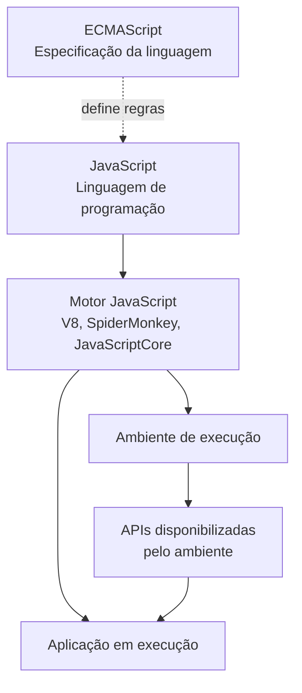
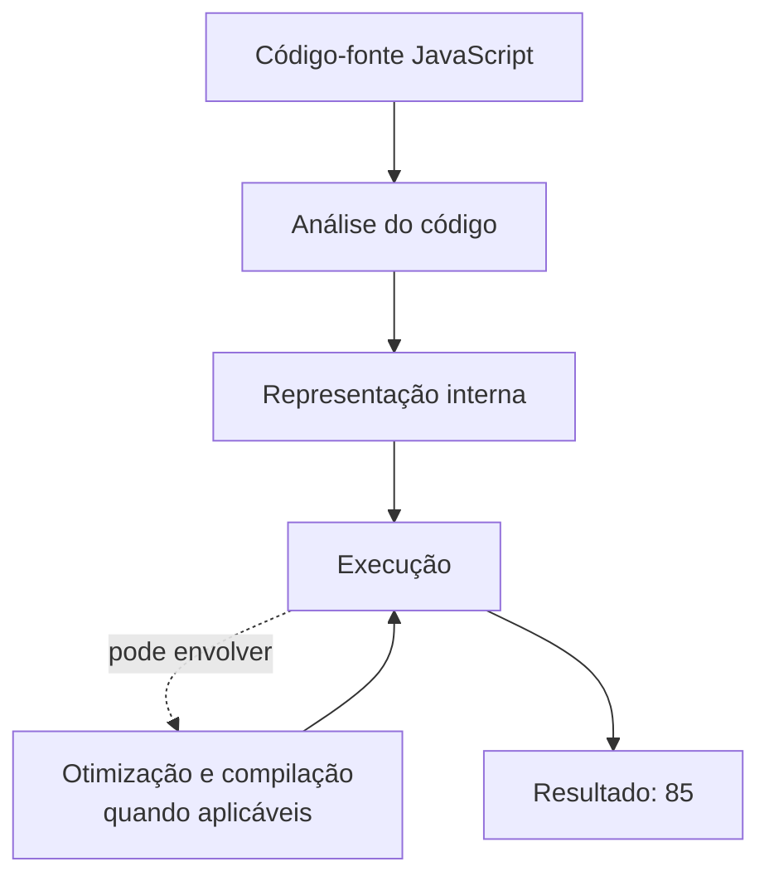
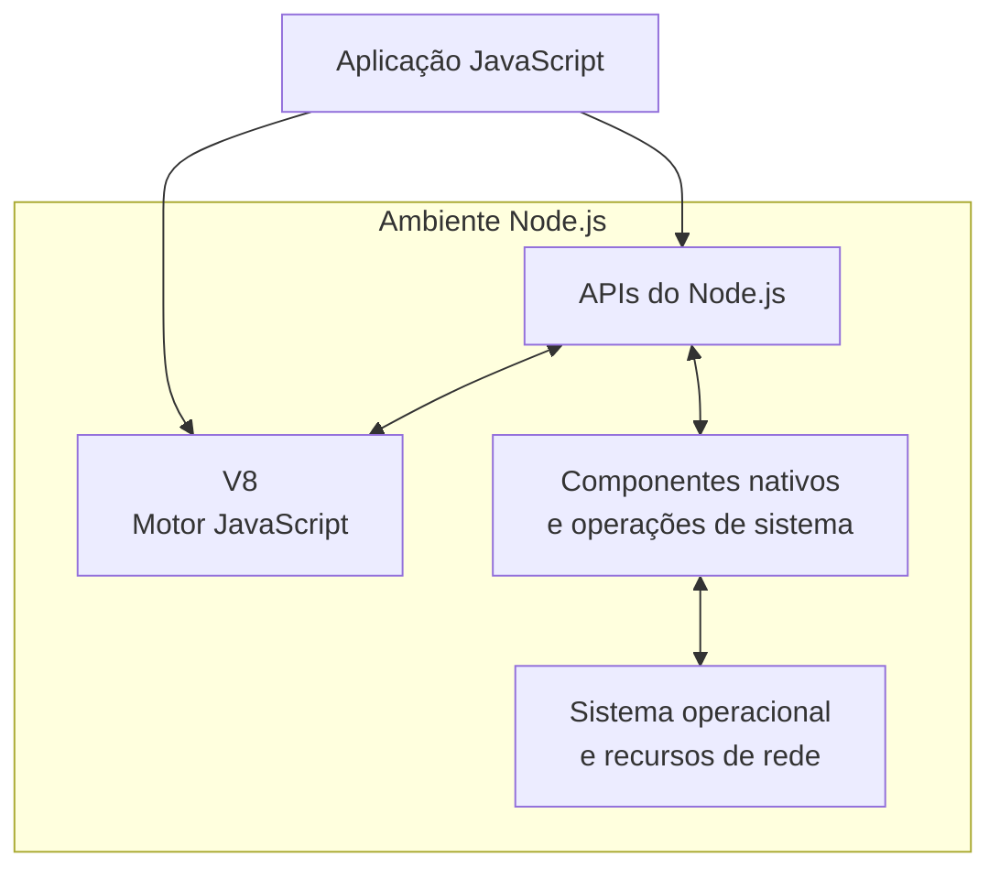

# 01 - JavaScript, ECMAScript, Node.js e Motores JavaScript

[](../LICENSE)
[](https://github.com/AntonioJavaDeveloper/mastering-typescript/stargazers)
[](https://github.com/AntonioJavaDeveloper/mastering-typescript/network/members)

---

## 🧭 Navegação

📂 [`README principal do repositório`](https://github.com/AntonioJavaDeveloper/mastering-typescript/blob/main/README.pt-BR.md)  
└── 📁 [`Introdução do capítulo`](./README.pt-BR.md)  
&emsp;&emsp;├── [`01 - JavaScript, ECMAScript, Node.js e Motores JavaScript`](./1-javascript-ecmascript-nodejs-e-motores.pt-BR.md) ← **você está aqui**  
&emsp;&emsp;├── [`02 - O que é TypeScript e Verificação de Tipos`](./2-o-que-e-typescript-e-verificacao-de-tipos.pt-BR.md)  
&emsp;&emsp;├── [`03 - Node.js e npm`](./3-nodejs-e-npm.pt-BR.md)  
&emsp;&emsp;├── [`04 - package.json e package-lock.json`](./4-package-json-e-package-lock.pt-BR.md)  
&emsp;&emsp;├── [`05 - Instalação e Gerenciamento de Dependências`](./5-instalacao-e-gerenciamento-de-dependencias.pt-BR.md)  
&emsp;&emsp;├── [`06 - TypeScript e Execução com tsc e tsx`](./6-typescript-e-execucao-com-tsc-e-tsx.pt-BR.md)  
&emsp;&emsp;├── [`07 - tsconfig.json: Configuração e Seleção de Arquivos`](./7-tsconfig-e-selecao-de-arquivos.pt-BR.md)  
&emsp;&emsp;├── [`08 - tsc: Argumentos, Arquivos e Projetos`](./8-tsc-argumentos-e-compilacao-de-projetos.pt-BR.md)  
&emsp;&emsp;└── [`09 - Verificação de Tipos e Execução Controlada`](./9-verificacao-de-tipos-e-execucao-controlada.pt-BR.md)

---

## 📖 Introdução

JavaScript, ECMAScript, motores JavaScript e Node.js são conceitos relacionados, mas representam componentes diferentes do ecossistema de desenvolvimento.

Compreender essas diferenças ajuda a explicar como o código é executado, quais recursos pertencem à linguagem e quais são disponibilizados pelo ambiente de execução.

Esse conhecimento também estabelece a base para compreender o TypeScript, que acrescenta recursos à experiência de desenvolvimento JavaScript, incluindo verificação estática de tipos.

Neste documento, vamos explorar esses conceitos e entender como eles se relacionam na execução de uma aplicação.

## 🎯 Objetivos de aprendizagem

Ao concluir esta leitura, você deverá ser capaz de:

- Diferenciar JavaScript de ECMAScript.
- Explicar o papel de um motor JavaScript.
- Reconhecer V8, SpiderMonkey e JavaScriptCore.
- Compreender o que é Node.js e sua relação com o V8.
- Distinguir recursos da linguagem de APIs disponibilizadas pelo ambiente.
- Identificar diferenças importantes entre JavaScript executado no navegador e no Node.js.

## 🧩 Visão geral do ecossistema

Antes de analisar cada conceito, observe como os componentes se relacionam.



O diagrama apresenta uma visão conceitual, não uma sequência rígida de implementação. Na prática, o motor e o ambiente de execução trabalham integrados para processar o código e disponibilizar funcionalidades à aplicação.

| Componente | Responsabilidade |
|---|---|
| JavaScript | Linguagem utilizada para escrever o código. |
| ECMAScript | Especificação que define os principais comportamentos padronizados da linguagem. |
| Motor JavaScript | Implementa os comportamentos da linguagem e executa o código. |
| Ambiente de execução | Integra o motor a APIs e outros componentes necessários à aplicação. |
| Node.js | Ambiente de execução de JavaScript fora do navegador, com APIs próprias. |
| TypeScript | Linguagem baseada em JavaScript que acrescenta recursos, como verificação estática de tipos. |

---

## 🟨 JavaScript e ECMAScript

### 💻 JavaScript como linguagem de programação

JavaScript é uma linguagem de programação de alto nível utilizada para implementar comportamentos, operações e regras de negócio.

Entre seus recursos estão:

- Variáveis e constantes.
- Tipos de dados e operadores.
- Condicionais e estruturas de repetição.
- Funções e closures.
- Objetos e classes.
- Módulos.
- Promises e `async`/`await`.

Considere o exemplo:

```javascript
const calculateTotal = (price, quantity) => {
  return price * quantity;
};

const total = calculateTotal(49.9, 3);

console.log(total);
```

O código declara uma função, recebe parâmetros, realiza uma operação e apresenta o resultado. A sintaxe e os comportamentos utilizados fazem parte dos recursos da linguagem JavaScript.

Mas de onde vêm as regras que determinam como esses recursos devem funcionar?

### 📖 O que é ECMAScript?

ECMAScript é a especificação que define os principais elementos e comportamentos padronizados da linguagem JavaScript.

Ela descreve aspectos como:

- Sintaxe e expressões.
- Tipos e valores fundamentais.
- Regras de avaliação de expressões.
- Funções e objetos.
- Módulos.
- Recursos incorporados à linguagem ao longo de sua evolução.

A evolução da especificação é conduzida pelo comitê técnico TC39, que trabalha na definição e padronização de novos recursos.

A especificação não é, por si só, um programa que executamos. Ela estabelece as regras que as implementações compatíveis devem seguir.

### ⚙️ O que significa implementar uma especificação?

Uma especificação descreve o comportamento esperado. Uma implementação transforma essas regras em um sistema funcional.

No ecossistema JavaScript, os motores implementam os comportamentos definidos pelo ECMAScript. Eles podem utilizar estruturas internas e técnicas de execução diferentes, desde que respeitem os requisitos aplicáveis da especificação.

Por exemplo:

```javascript
const language = "JavaScript";

console.log(language.toUpperCase());
```

O método `toUpperCase()` faz parte dos recursos padronizados para strings. O motor precisa implementar esse comportamento para que o código produza o resultado esperado.

Isso não significa que todos os motores utilizem o mesmo código interno ou as mesmas estratégias de execução.

### 🔗 Qual é a diferença entre JavaScript e ECMAScript?

A diferença principal está no papel de cada termo:

- **JavaScript** é o nome da linguagem utilizada pelos desenvolvedores.
- **ECMAScript** é a especificação que define boa parte de seus comportamentos padronizados.

Podemos pensar no ECMAScript como uma referência normativa para a implementação da linguagem JavaScript.

Entretanto, nem todas as funcionalidades disponíveis em um programa JavaScript são definidas pelo ECMAScript. Recursos como `document`, no navegador, e `process`, no Node.js, são disponibilizados pelos respectivos ambientes.

### 🗓️ Versões do ECMAScript

A especificação evolui ao longo do tempo, incorporando novos recursos e aprimorando a linguagem.

Você encontrará referências como ES2015, também conhecido como ES6, e ES2020. Esses nomes identificam edições ou marcos da evolução do ECMAScript.

A disponibilidade de um recurso depende do suporte oferecido pelo motor e pelo ambiente de execução.

Por isso, conhecer uma versão da especificação não garante, isoladamente, que todos os seus recursos estejam disponíveis em qualquer navegador ou versão do Node.js.

---

## ⚙️ Motores JavaScript

### 🔍 O que é um motor JavaScript?

Um motor JavaScript (*JavaScript engine*) é o componente responsável por processar e executar o código JavaScript.

Ele analisa a estrutura do código, identifica erros sintáticos e utiliza mecanismos internos para executar as operações solicitadas pelo programa.

Motores modernos podem combinar interpretação, compilação para código de máquina e otimizações realizadas durante a execução.

### 🔄 Como o código JavaScript é executado?

Considere:

```javascript
const price = 100;
const discount = 15;

console.log(price - discount);
```

De forma simplificada, o motor precisa analisar o código, preparar sua representação interna e executar as operações necessárias.



O fluxo é conceitual. Os detalhes variam entre motores, versões e situações de execução.

Em linhas gerais:

- **Análise:** o motor verifica a estrutura do código. Um erro de sintaxe pode impedir sua execução.
- **Representação interna:** o código é convertido em estruturas que o motor consegue processar.
- **Execução:** as instruções são realizadas de acordo com as regras da linguagem.
- **Otimização:** quando apropriado, o motor pode compilar partes do código e otimizar operações para melhorar o desempenho.

Esses mecanismos ajudam a explicar como JavaScript pode ser executado eficientemente sem que o desenvolvedor precise escrever diretamente código de máquina.

### 🏎️ Principais motores JavaScript

Existem diferentes motores, desenvolvidos e mantidos por projetos distintos.

| Motor | Projeto associado | Exemplos de utilização |
|---|---|---|
| V8 | Projeto V8, associado ao Google | Google Chrome e Node.js. |
| SpiderMonkey | Mozilla | Firefox. |
| JavaScriptCore | Projeto WebKit, associado à Apple | Safari e outros ambientes baseados em WebKit. |

Os motores podem apresentar diferenças nas estratégias de otimização, no desempenho e no suporte a recursos conforme suas versões.

Para o desenvolvedor, isso significa que é necessário conhecer o ambiente de destino e verificar quais recursos ele oferece.

### 🧠 Motor JavaScript não é a linguagem

JavaScript define os recursos e comportamentos esperados da linguagem. O motor é o software que implementa esses comportamentos e executa o código.

Essa separação ajuda a compreender por que o mesmo programa pode funcionar em ambientes diferentes, enquanto certas funcionalidades dependem especificamente do navegador ou do Node.js.

---

## 🟩 Node.js

### 🖥️ O que é Node.js?

Node.js é um ambiente de execução (*runtime*) que permite executar JavaScript fora do navegador.

Ele é amplamente utilizado para desenvolver:

- APIs e serviços de backend.
- Servidores HTTP.
- Ferramentas de linha de comando.
- Scripts de automação.
- Ferramentas de desenvolvimento.
- Aplicações que precisam realizar operações de entrada e saída.

O Node.js integra o motor V8 a outros componentes e APIs que permitem trabalhar com arquivos, rede, processos e diferentes recursos do sistema.

**Node.js não é uma linguagem de programação nem um motor JavaScript.** É um ambiente que integra um motor e outros componentes necessários para executar aplicações.

### 🧱 Como Node.js e V8 trabalham juntos?

O Node.js utiliza o V8 para executar JavaScript e disponibiliza funcionalidades que não fazem parte do núcleo padronizado da linguagem.



Esse diagrama é uma representação simplificada. A arquitetura interna do Node.js possui outros componentes, e a interação entre eles depende da operação realizada.

Considere a leitura de um arquivo:

```javascript
import { readFile } from "node:fs/promises";

const content = await readFile("./example.txt", "utf8");

console.log(content);
```

Nesse exemplo:

- JavaScript fornece a sintaxe, as variáveis e o `await`.
- O módulo `node:fs/promises` é disponibilizado pelo Node.js.
- O ambiente realiza a integração necessária com o sistema de arquivos.
- O V8 executa o código JavaScript que coordena a operação e trata o resultado.

O exemplo utiliza módulos ECMAScript. Para executá-lo, o arquivo e o projeto precisam estar configurados de maneira compatível com módulos ES no Node.js.

### 🧰 APIs disponibilizadas pelo Node.js

O Node.js oferece APIs que permitem realizar tarefas que não fazem parte do núcleo da linguagem ECMAScript.

| API | Finalidade | Exemplo de utilização |
|---|---|---|
| `node:fs` | Trabalhar com arquivos e diretórios. | Ler um arquivo de configuração. |
| `node:http` | Criar clientes e servidores HTTP. | Implementar um servidor web. |
| `process` | Consultar informações e interagir com o processo atual. | Ler argumentos e variáveis de ambiente. |
| `Buffer` | Manipular sequências de bytes. | Processar dados binários. |

Algumas APIs precisam ser importadas explicitamente, como `node:fs` e `node:http`. Outras, como `process` e `Buffer`, estão disponíveis globalmente no Node.js.

Por exemplo, o objeto `process` permite consultar informações do ambiente de execução:

```javascript
console.log(process.version);
console.log(process.platform);
```

Já `Buffer` permite trabalhar com dados binários:

```javascript
const buffer = Buffer.from("JavaScript", "utf8");

console.log(buffer);
console.log(buffer.toString("utf8"));
```

A documentação oficial do Node.js descreve as APIs disponíveis e as diferenças entre suas versões.

### 🌐 JavaScript no navegador e no Node.js

A linguagem pode ser executada em diferentes ambientes. Embora os recursos fundamentais do JavaScript sejam relacionados ao ECMAScript, as APIs disponíveis dependem do ambiente hospedeiro.

No navegador, JavaScript pode manipular páginas HTML, responder a eventos e interagir com recursos da plataforma Web.

No Node.js, JavaScript pode acessar arquivos por meio das APIs do ambiente, criar servidores e executar operações no sistema em que o processo possui permissão para atuar.

| Recurso | Navegador | Node.js |
|---|---|---|
| Recursos fundamentais do JavaScript | Sim, conforme o suporte do motor. | Sim, conforme o suporte do motor. |
| `document` e manipulação do DOM | Disponíveis em contextos com DOM. | Não são APIs globais padrão do Node.js. |
| `window` | Disponível em contextos de janela. | Não é o objeto global tradicional do Node.js. |
| Módulo `node:fs` | Não está disponível como API nativa do navegador. | Disponível para trabalhar com arquivos. |
| Módulo `node:http` | Não é uma API nativa do navegador. | Disponível para operações HTTP de servidor e cliente. |
| `process` e `Buffer` | Não são APIs padrão do navegador. | Disponíveis no Node.js. |

A tabela apresenta diferenças gerais. A disponibilidade de recursos pode variar conforme o navegador, a versão do Node.js e as permissões concedidas.

Veja dois exemplos.

No navegador:

```javascript
document.querySelector("h1").textContent = "Olá!";
```

No Node.js:

```javascript
import { writeFile } from "node:fs/promises";

await writeFile("./message.txt", "Olá!", "utf8");
```

O primeiro exemplo altera o conteúdo de um elemento da página. O segundo grava um arquivo no sistema de arquivos acessível ao processo.

É importante não confundir a linguagem JavaScript com as APIs que cada ambiente disponibiliza.

### 🧭 ECMAScript, APIs Web e APIs do Node.js

Podemos organizar os recursos em três categorias.

**Recursos do ECMAScript**

São os recursos padronizados da linguagem, como `const`, funções, classes, arrays, Promises e módulos.

**APIs Web**

São interfaces definidas por padrões da plataforma Web e disponibilizadas por navegadores e, em alguns casos, por outros ambientes. Entre elas estão o DOM e diversas APIs para interação com páginas, rede e outros recursos.

Algumas APIs Web também estão disponíveis no Node.js. Por exemplo, versões modernas do Node.js oferecem `fetch` global. Portanto, nem toda API Web é exclusiva do navegador.

**APIs específicas do Node.js**

São funcionalidades oferecidas pelo ambiente, como `node:fs`, `node:http`, `process` e `Buffer`.

Essa distinção permite identificar a origem de uma funcionalidade, consultar a documentação correta e avaliar sua disponibilidade no ambiente de destino.

---

## 💡 Por que esses conceitos são importantes para TypeScript?

TypeScript acrescenta recursos à experiência de desenvolvimento JavaScript, incluindo um sistema de tipos estáticos. Entretanto, o código TypeScript normalmente é transformado em JavaScript para execução.

Compreender JavaScript e os ambientes em que ele é executado ajuda a entender três aspectos:

- O sistema de tipos do TypeScript não substitui o funcionamento da linguagem JavaScript em tempo de execução.
- O JavaScript gerado precisa ser compatível com o ambiente de destino.
- A disponibilidade de APIs continua dependendo do ambiente, mesmo quando o código é escrito em TypeScript.

Esses pontos serão aprofundados nos próximos documentos, quando estudaremos o TypeScript, a verificação de tipos e as ferramentas de execução.

---

## 📚 Leitura complementar

Para aprofundar os conceitos apresentados, consulte a documentação oficial:

- 📘 [ECMAScript — Especificação oficial](https://tc39.es/ecma262/)
- 🟢 [Node.js — Documentação oficial](https://nodejs.org/docs/latest/api/)
- 🧭 [Node.js — Introdução ao ambiente de execução](https://nodejs.org/en/learn/getting-started/introduction-to-nodejs)
- ⚙️ [V8 — Documentação oficial](https://v8.dev/docs)
- 🦊 [SpiderMonkey — Documentação técnica da Mozilla](https://firefox-source-docs.mozilla.org/js/)
- 🌐 [MDN — JavaScript](https://developer.mozilla.org/pt-BR/docs/Web/JavaScript)
- 🧩 [TypeScript — Documentação oficial](https://www.typescriptlang.org/docs/)

---

## 📬 Contribuições

Se este projeto te ajudou ou inspirou, considere deixar uma estrela ⭐ no repositório!

Sinta-se à vontade para abrir *issues* com sugestões, correções ou dúvidas. Este repositório é um espaço voltado à **evolução constante** e à consolidação de boas práticas no desenvolvimento de software com TypeScript.

Toda colaboração construtiva será analisada com atenção.

---

## 🔗 Navegação Rápida

⬅️ Retornar à [`Introdução do capítulo`](./README.pt-BR.md)

➡️ Avançar para [`02 - O que é TypeScript e Verificação de Tipos`](./2-o-que-e-typescript-e-verificacao-de-tipos.pt-BR.md)

🏠 Retornar ao [`README principal do repositório`](https://github.com/AntonioJavaDeveloper/mastering-typescript/blob/main/README.pt-BR.md)

---

## 📫 Contato

Caso queira trocar experiências sobre desenvolvimento de software, arquitetura de aplicações, Java, TypeScript ou tecnologia em geral, você pode me encontrar através dos canais abaixo:

- 🌐 [javadeveloper.com.br](https://javadeveloper.com.br/)
- 💼 [LinkedIn](https://www.linkedin.com/in/antonio-javadeveloper/)
- 📧 [antonio@javadeveloper.com.br](mailto:antonio@javadeveloper.com.br)

> Developed by [AntonioJavaDeveloper](https://github.com/AntonioJavaDeveloper)
