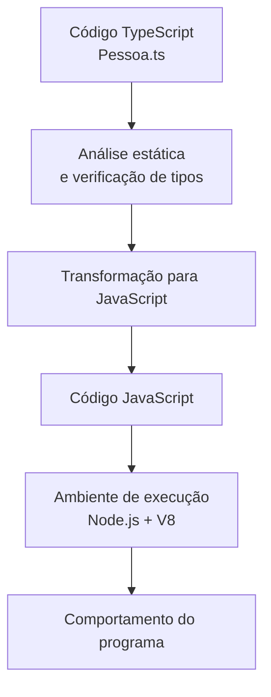

# 02 - TypeScript e Verificação de Tipos

[](../LICENSE)
[](https://github.com/AntonioJavaDeveloper/mastering-typescript/stargazers)
[](https://github.com/AntonioJavaDeveloper/mastering-typescript/network/members)

---

## 🧭 Navegação

📂 [`README principal do repositório`](https://github.com/AntonioJavaDeveloper/mastering-typescript/blob/main/README.pt-BR.md)  
└── 📁 [`Introdução do capítulo`](./README.pt-BR.md)  
&emsp;&emsp;├── [`01 - JavaScript, ECMAScript, Node.js e Motores JavaScript`](./1-javascript-ecmascript-nodejs-e-motores.pt-BR.md)  
&emsp;&emsp;├── [`02 - TypeScript e Verificação de Tipos`](./2-o-que-e-typescript-e-verificacao-de-tipos.pt-BR.md) ← **você está aqui**  
&emsp;&emsp;├── [`03 - Node.js e npm`](./3-nodejs-e-npm.pt-BR.md)  
&emsp;&emsp;├── [`04 - package.json e package-lock.json`](./4-package-json-e-package-lock.pt-BR.md)  
&emsp;&emsp;├── [`05 - Instalação e Gerenciamento de Dependências`](./5-instalacao-e-gerenciamento-de-dependencias.pt-BR.md)  
&emsp;&emsp;├── [`06 - TypeScript e Execução com tsc e tsx`](./6-typescript-e-execucao-com-tsc-e-tsx.pt-BR.md)  
&emsp;&emsp;├── [`07 - tsconfig.json: Configuração e Seleção de Arquivos`](./7-tsconfig-e-selecao-de-arquivos.pt-BR.md)  
&emsp;&emsp;├── [`08 - tsc: Argumentos, Arquivos e Projetos`](./8-tsc-argumentos-e-compilacao-de-projetos.pt-BR.md)  
&emsp;&emsp;└── [`09 - Verificação de Tipos e Execução Controlada`](./9-verificacao-de-tipos-e-execucao-controlada.pt-BR.md)

---

## 📖 Introdução

No documento anterior, conhecemos JavaScript, ECMAScript, os motores JavaScript e o Node.js. Agora, vamos estudar o TypeScript e entender como ele ajuda a identificar problemas no código antes da execução.

Conhecer JavaScript é importante para compreender porque o TypeScript se baseia na linguagem JavaScript, acrescentando recursos voltados principalmente à análise estática e à segurança durante o desenvolvimento.

Neste documento, utilizaremos a classe `Pessoa`, localizada no diretório de código-fonte deste capítulo, para observar como o TypeScript identifica um acesso inválido a uma propriedade privada.

O objetivo não é aprofundar os conceitos de orientação a objetos neste momento. Vamos utilizar a classe como um exemplo prático para compreender o que o TypeScript verifica, o que acontece durante a transformação do código e por que um programa pode ser executado mesmo quando o editor sinaliza um erro de tipos.

## 🎯 Objetivos de aprendizagem

Ao concluir esta leitura, você deverá ser capaz de:

- Explicar o que é TypeScript e qual é sua relação com JavaScript.
- Compreender os conceitos básicos de tipos estáticos e inferência de tipos.
- Reconhecer classes, propriedades e modificadores de acesso em um exemplo.
- Diferenciar análise estática de execução do programa.
- Entender a diferença entre `private` no TypeScript e campos privados nativos do JavaScript.
- Realizar uma verificação inicial com `npx tsc --noEmit`.

## 🟦 O que é TypeScript?

### 💻 Uma linguagem baseada em JavaScript

TypeScript é uma linguagem de programação desenvolvida sobre JavaScript, que acrescenta recursos como anotações de tipos, verificação estática e ferramentas para facilitar a manutenção de aplicações.

O TypeScript permite declarar informações sobre os tipos de dados esperados, ajudando a identificar determinadas inconsistências durante o desenvolvimento.

Observe o exemplo em JavaScript:

```javascript
function calculateTotal(price, quantity) {
  return price * quantity;
}

console.log(calculateTotal(50, 3));
```

Agora, veja uma versão escrita em TypeScript:

```typescript
function calculateTotal(price: number, quantity: number): number {
  return price * quantity;
}

console.log(calculateTotal(50, 3));
```

A diferença está nas anotações `: number`, que indicam que os parâmetros e o resultado esperado são numéricos.

Com essas informações, o TypeScript pode identificar usos incompatíveis com os tipos declarados antes de o programa ser executado.

### 🧩 Tipos estáticos

Um sistema de tipos permite descrever quais valores podem ser utilizados em determinadas situações e verificar se as operações são compatíveis com essas descrições.

No TypeScript, essa análise pode identificar problemas como passar uma string para uma função que espera um número.

```typescript
function greet(name: string): string {
  return `Olá, ${name}!`;
}

greet("Maria");

// Erro de tipo: um número não corresponde ao tipo string.
greet(123);
```

O TypeScript sinaliza que `123` não corresponde ao tipo `string` esperado pelo parâmetro `name`.

Esse diagnóstico é produzido pela análise estática. Ele não representa, por si só, uma exceção que necessariamente ocorrerá em tempo de execução.

É importante observar que o TypeScript não garante a ausência de todos os erros. O sistema de tipos possui limites, e alguns problemas só podem ser identificados durante a execução.

### 🔎 Inferência de tipos

Nem sempre é necessário declarar explicitamente o tipo de uma variável. O TypeScript consegue inferir tipos a partir dos valores e do contexto.

```typescript
const language = "TypeScript";
const version = 7;
let nome = "Antonio";

console.log(language);
console.log(version);
console.log(nome);
```

Nesse exemplo, o TypeScript infere os tipos com base nos valores atribuídos às constantes.

| Declaração | Tipo inferido |
|---|---|
| `const language = "TypeScript"` | Literal `"TypeScript"` |
| `const version = 7` | Literal `7` |
| `let nome = "Antonio"` | string `"Antonio"` |

Em declarações com `const`, o TypeScript pode inferir tipos literais, mais específicos do que simplesmente `string` ou `number`. Em outros contextos, como variáveis declaradas com `let`, a inferência pode resultar em tipos mais amplos como `string`.

A inferência reduz a necessidade de anotações repetitivas sem eliminar a verificação de tipos.

Não se preocupe caso não tenha entendido o que são literais. Esse não é o foco. Basta saber que mesmo não colocando explicitamente o tipo da variável ou constante o TypeScript vai inferir um tipo para aquela variável ou constante.

### 🏗️ Classes, propriedades e modificadores de acesso

O TypeScript também oferece recursos para descrever estruturas de objetos, incluindo classes, propriedades, métodos, getters, setters e modificadores de acesso.

Veja um exemplo simplificado:

```typescript
class Pessoa {
  private primeiroNome: string = "";

  get nome(): string {
    return this.primeiroNome;
  }
}

const cliente = new Pessoa();
```

Nesse exemplo:

- `class Pessoa` declara uma classe.
- `primeiroNome` é uma propriedade cujo tipo declarado é `string`.
- `private` restringe o acesso direto à propriedade segundo as regras de verificação do TypeScript.
- `get nome()` declara um getter, que permite consultar o nome por meio de `cliente.nome`.

Não é necessário dominar orientação a objetos para acompanhar o restante deste documento. Por enquanto, basta compreender que uma classe pode declarar propriedades e que o TypeScript verifica se elas são acessadas de acordo com as regras estabelecidas.

### 🔗 Relação entre TypeScript e JavaScript

O TypeScript não substitui o motor JavaScript. Em um fluxo comum de desenvolvimento, o código TypeScript é transformado em JavaScript, que pode então ser executado em um ambiente compatível.

Esse processo costuma ser chamado de *transpilação*: a transformação de código de uma linguagem ou versão para outra, preservando a intenção do programa.



O diagrama apresenta um fluxo conceitual. As ferramentas podem combinar ou separar essas etapas, e nem toda ferramenta de execução realiza uma verificação completa de tipos automaticamente.

### ➕ O que o TypeScript acrescenta e o que não muda?

| Aspecto | TypeScript | JavaScript em execução |
|---|---|---|
| Anotações de tipos | Permite declarar tipos como `string` e `number`. | Essas anotações normalmente não existem no código JavaScript gerado. |
| Verificação estática | Pode identificar incompatibilidades antes da execução. | Não executa, por si só, a verificação estática do TypeScript. |
| Inferência de tipos | Deduz tipos a partir de valores e contextos. | Não mantém o sistema de tipos estáticos do TypeScript em tempo de execução. |
| Classes e métodos | Oferece recursos adicionais de análise e declaração. | O comportamento depende do JavaScript gerado e do ambiente de execução. |
| Execução | Precisa ser transformado ou processado por uma ferramenta compatível. | É executado por um motor JavaScript em um ambiente apropriado. |

A transformação do TypeScript para JavaScript normalmente remove as anotações de tipos e outros elementos exclusivos do TypeScript. Ela não transforma automaticamente todas as regras verificadas em proteções de tempo de execução.

Essa diferença será importante no exemplo da classe `Pessoa`.

---

## 🔬 O que acontece quando o TypeScript identifica um erro?

### 🧭 Análise estática e execução são coisas diferentes

A **análise estática** *examina o código sem precisar executar o programa para verificar determinadas propriedades*, incluindo compatibilidade de tipos e regras de acesso.

A **execução**, por outro lado, *consiste em realizar as operações do programa em um ambiente de execução*.

Por isso, precisamos separar duas perguntas:

- **O TypeScript considera o código válido?** Essa pergunta está relacionada à análise estática e às regras de tipos.
- **O que acontece quando o código JavaScript é executado?** Essa pergunta está relacionada ao comportamento em tempo de execução.

Um programa pode apresentar um diagnóstico de erro do TypeScript e, ainda assim, ser executado por uma ferramenta que apenas transforma o código e não interrompe a execução por causa daquele diagnóstico.

### 👤 Conhecendo a classe `Pessoa`

O arquivo utilizado neste exercício está localizado em:

```text
src/
└── 02-typescript-environment-and-dependencies/
    └── Pessoa.ts
```

A classe contém propriedades privadas, um getter e um setter para o nome, além de um getter e um setter para a idade.

Observe os trechos relevantes do arquivo:

```typescript
class Pessoa {
  private primeiroNome: string = "";
  private ultimoNome: string = "";
  private _idade: number = 0;

  get nome(): string {
    return `${this.primeiroNome} ${this.ultimoNome}`;
  }

  set nome(nomeCompleto: string) {
    const partesDoNome = nomeCompleto.trim().split(/\s+/);

    this.primeiroNome = partesDoNome[0] ?? "";

    this.ultimoNome =
      partesDoNome.length > 1
        ? partesDoNome[partesDoNome.length - 1]
        : "";
  }

  get idade(): number {
    return this._idade;
  }

  set idade(idade: number) {
    this._idade = idade;
  }
}

const cliente = new Pessoa();

cliente.nome = "José da Silva";
cliente.idade = 25;
```

O setter `nome` recebe o nome completo, separa as palavras e armazena a primeira e a última parte nas propriedades correspondentes. O getter `nome` permite consultar o nome completo sem acessar diretamente essas propriedades.

O setter `idade` atribui o valor à propriedade `_idade`, enquanto o getter `idade` permite consultá-la.

Esses detalhes ajudam a entender o exemplo, mas não precisamos aprofundar agora a implementação de getters, setters ou a modelagem de classes.

### 🔒 Por que `cliente.primeiroNome` gera um diagnóstico?

A propriedade `primeiroNome` foi declarada com o modificador `private`.

No TypeScript, esse modificador restringe o acesso à propriedade durante a verificação estática. Assim, o código abaixo é considerado inválido:

```typescript
// Erro de verificação de tipos:
// a propriedade primeiroNome é privada.
console.log(`Meu primeiro nome é ${cliente.primeiroNome}`);
```

O TypeScript pode apresentar um diagnóstico semelhante a:

```text
Property 'primeiroNome' is private and only accessible within class 'Pessoa'.
```

O texto exato pode variar conforme a versão e a ferramenta utilizada, mas a causa é a mesma: o acesso está sendo feito fora da classe.

Se a intenção é obter o nome completo, o código pode utilizar o getter público:

```typescript
console.log(`Meu nome completo é ${cliente.nome}`);
```

O acesso a `cliente.nome` respeita a interface disponibilizada pela classe e permite que o getter retorne o valor formatado.

### ⚠️ O `private` do TypeScript não é uma proteção de execução

Este é um dos pontos mais importantes do exercício.

O modificador `private` tradicional do TypeScript é uma restrição verificada durante o desenvolvimento. Ele não cria, por si só, uma barreira de acesso equivalente a um campo privado nativo do JavaScript.

Ao transformar a classe para JavaScript, o modificador `private` tradicional é removido. A propriedade correspondente pode continuar existindo como uma propriedade comum do objeto em tempo de execução.

Por isso, uma ferramenta como `tsx`, que transforma e executa TypeScript sem realizar necessariamente uma verificação completa de tipos, pode executar o acesso direto a `cliente.primeiroNome`, mesmo que o TypeScript o considere inválido.

Isso não significa que o diagnóstico esteja errado. Significa que a ferramenta de execução e o verificador de tipos desempenham papéis diferentes.

### 🔐 E os campos privados nativos do JavaScript?

O JavaScript também possui campos privados nativos, declarados com `#`.

Por exemplo:

```javascript
class Pessoa {
  #primeiroNome = "José";

  get nome() {
    return this.#primeiroNome;
  }
}

const cliente = new Pessoa();

console.log(cliente.nome);

// Erro em tempo de execução:
// console.log(cliente.#primeiroNome);
```

O acesso direto a `cliente.#primeiroNome` fora da classe é inválido na própria linguagem JavaScript. Se esse acesso for colocado em código executável, o programa não poderá ser analisado como JavaScript válido.

Diferentemente do `private` tradicional do TypeScript, os campos `#private` oferecem privacidade imposta pela linguagem em tempo de execução.

| Característica | `private` do TypeScript | Campo `#private` do JavaScript |
|---|---|---|
| Finalidade | Restringir o acesso durante a verificação estática. | Restringir o acesso por meio de um recurso nativo da linguagem. |
| Verificação de acesso | Feita pelo TypeScript. | Imposta pela linguagem JavaScript. |
| Comportamento após transformação | A restrição tradicional é removida. | A privacidade é preservada se o campo for emitido como campo privado nativo ou transformado com mecanismos equivalentes. |
| Acesso direto fora da classe | Gera diagnóstico do TypeScript. | É inválido e não pode ser usado como acesso comum em JavaScript. |

Essa distinção ajuda a compreender por que a verificação de tipos não deve ser confundida com uma proteção automática em tempo de execução.

### 🧪 Experimento: comparar o editor e a execução

Vamos utilizar o arquivo `Pessoa.ts` que já existe no projeto.

Primeiro, mantenha comentada a linha de acesso direto à propriedade privada:

```typescript
// console.log(`Meu primeiro nome é ${cliente.primeiroNome}`);
```

E mantenha descomentada a linha que acessa o getter público:

```typescript
console.log(`Meu nome completo é ${cliente.nome}`);
```

Com essa configuração, o acesso ao nome completo respeita as regras de acesso do TypeScript.

Agora, experimente o seguinte:

1. Descomente a linha que acessa `cliente.primeiroNome`. Nesse momento você esta acessando um atributo privado
2. Observe o diagnóstico exibido pelo VS Code. Irá aparecer uma mensagem que algo esta errado.
3. Execute o arquivo com `tsx`, conforme o comando de execução utilizado no capítulo. `npx tsx src/02-typescript-environment-and-dependencies/Pessoa.ts`
4. Compare o diagnóstico do editor com o comportamento observado no terminal. Ainda que esteja apresentando uma mensagem de erro o código foi executado. Ou seja, ainda que a etapa de checagem estática identifique uma inconsistência o código é transpilado.
5. Volte o código como estava antes. Comente a linha que acessa `cliente.primeiroNome`. Mantenha a linha do acesso por meio do getter descomentada.

Como `private` tradicional do TypeScript não é uma barreira de execução, o código transformado pode conseguir ler a propriedade em tempo de execução. O resultado concreto dependerá das linhas que estiverem descomentadas.

**Importante:** executar o programa com sucesso não significa que o código passou na verificação de tipos. São verificações diferentes, com objetivos diferentes.

---

## 🛠️ Conhecendo o compilador `tsc`

### ⚙️ O que é o TypeScript Compiler?

O `tsc` é o compilador oficial do TypeScript (*TypeScript Compiler*).

Entre suas responsabilidades estão analisar o código TypeScript, verificar tipos e, quando solicitado, gerar código JavaScript.

Neste documento, vamos utilizar o compilador apenas para verificar o arquivo `Pessoa.ts`, sem gerar arquivos JavaScript.

As opções mais avançadas e o funcionamento detalhado do compilador serão abordados posteriormente.

### 📦 O que significa executar `npx tsc`?

O comando `npx` é uma ferramenta associada ao npm que permite executar comandos fornecidos por pacotes.

Neste projeto, o TypeScript está instalado como dependência de desenvolvimento. Seus arquivos ficam normalmente em `node_modules`, e o executável `tsc` fica acessível por meio dos binários locais do projeto.

Ao executar:

```bash
npx tsc --noEmit
```

o `npx` localiza e executa o compilador TypeScript disponível no projeto. Em determinadas situações, o `npx` também pode oferecer a execução de um pacote que ainda não está instalado localmente; por isso, é importante conhecer a origem do comando que está sendo executado.

Não precisamos aprofundar agora o funcionamento do npm, do `npx` ou da estrutura `node_modules`. Esses assuntos terão documentos próprios neste capítulo.

### 🧪 Verificando o arquivo `Pessoa.ts`

Nesse momento o arquivo `src/02-typescript-environment-and-dependencies/Pessoa.ts` encontra-se com a linha de acesso a propriedade privada comentada. Se não estiver comentada comente.

```typescript
// console.log(`Meu primeiro nome é ${cliente.primeiroNome}`);
```

Sabemos que `cliente.nome` é público. E a linha de acesso a `cliente.nome` deve permanecer descomentada.

```typescript
// console.log(`Meu primeiro nome é ${cliente.primeiroNome}`);
console.log(`Meu nome completo é ${cliente.nome}`)
```

No terminal, na raiz do repositório, execute:

```bash
npx tsc --noEmit src/02-typescript-environment-and-dependencies/Pessoa.ts
```

Esse comando solicita ao compilador que verifique o arquivo indicado, sem emitir arquivos JavaScript, ou seja, não irá ocorrer a transpilação do código TypeScript em código JavaScript. Esse comando somente irá fazer as checagens estáticas no código TypeScript informado.

O caminho precisa corresponder à estrutura real do repositório até chegar no arquivo em questão. 

Perceba que a execução do comando não vai retornar nenhuma saída. Mas será que essa execução não retorna nenhuma informação? Queremos saber se o comando obteve saída com sucesso ou teve falha.

Embora o TypeScript e o VS Code tenham sido criados pela Microsoft, imensa maioria dos ambientes de produção que rodam TypeScript hoje é baseada em Linux. Então a explicação dessa seção será baseada nesse ecossistema.

Um *exit code* (ou *código de retorno*) **é um número inteiro enviado por um programa ou comando ao sistema operacional assim que ele termina de ser executado.** Esse número serve como uma resposta automática para dizer ao sistema operacional — ou a quem chamou o programa — se a tarefa foi realizada com sucesso ou se ocorreu algum erro.

No **Linux**, todo comando retorna um número ao finalizar:

- ` 0 ` significa sucesso (o comando funcionou perfeitamente).
- *Qualquer número diferente de zero (como 1, 2, 127, etc.) significa erro (o comando falhou por algum motivo).*

A variável especial `$?` armazena o *código de retorno* (ou *exit code*) do último comando executado no terminal Linux. Para ver o retorno do último comando, você deve usar o comando `echo $?`. Caso esteja no linux digite a sequência dos dois comandos abaixo. Caso esteja utilizando Microsoft Windows só acompanhe a explicação que ainda assim é muito importante.

```bash
npx tsc --noEmit src/02-typescript-environment-and-dependencies/Pessoa.ts
echo $?
```

Veja que a saída será `0`:

```bash
npx tsc --noEmit src/02-typescript-environment-and-dependencies/Pessoa.ts
echo $?
0
```

É retornado internamento um código de sucesso pelo `npx tsc --noEmit src/02-typescript-environment-and-dependencies/Pessoa.ts`, ainda que não possamos ver.

Agora, no arquivo `src/02-typescript-environment-and-dependencies/Pessoa.ts`, comente a linha que acessa um membro público `cliente.nome` e descomente a linha que acessa um membro privado, `cliente.primeiroNome`. Deverá ocorrer um erro. Veja o código abaixo:

```typescript
console.log(`Meu primeiro nome é ${cliente.primeiroNome}`);
//console.log(`Meu nome completo é ${cliente.nome}`)
```

Agora digite somente o comando abaixo.

```bash
npx tsc --noEmit src/02-typescript-environment-and-dependencies/Pessoa.ts
```
Você verá algo parecido com:


*Figura 1 — O erro identificado pelo Visual Studio Code e o retorno no terminal.*

Realizamos uma checagem estática. O desenvolvedor consegue analisar qual erro ocorreu. O ponto é que essa informação *não* é um indicativo de sucesso ou falha. O *exit code*(ou *código de retorno*) é o indicativo de sucesso ou falha para o Sistema Operacional ou outro sistema que esta se utilizando do *Compilador do TypeScript*. Já sabemos que `0` indica sucesso e qualquer número diferente de zero indica que houve falha. Para analisar o *exit code* do camando anterior devemos executar o comando `echo $?`. Veja a imagem abaixo:


*Figura 2 — Exit code para o comando anterior.*

Veja na figura anterior, na parte de baixo, a saída do comando `echo $?` foi `1`, indicando erro ou falha.

A opção `--noEmit` impede a geração de arquivos de saída. Ela não desativa a análise estática: o compilador continua verificando o código e pode apresentar diagnósticos.

**Uma observação importante:** o arquivo `tsconfig.json` é o arquivo de configuração do TypeScript. Nele, normalmente ficam definidas opções de compilação e regras de verificação que serão utilizadas pelo projeto.

Quando executamos o `tsc` informando diretamente um arquivo na linha de comando, como no exemplo:

```bash
npx tsc --noEmit src/02-typescript-environment-and-dependencies/Pessoa.ts
```

o compilador trata esse arquivo como uma entrada explícita. Nessa situação, ele não utiliza as configurações definidas no `tsconfig.json` do projeto da mesma forma. É comum configurar no arquivo `tsconfig.json` para fazer uma verificação do projeto inteiro. Mas adiante nesse capítulo aprenderemos como fazer essa verificação de todos os arquivos do projeto.

Em outras palavras, passar o nome do arquivo no comando pode produzir um comportamento diferente daquele obtido ao executar apenas:

```bash
npx tsc --noEmit
```

As diferenças entre verificar um arquivo específico e verificar um projeto configurado por meio do `tsconfig.json` serão estudadas em detalhes em outro documento.

### 📋 Como interpretar o resultado?

O resultado depende da configuração atual do arquivo `Pessoa.ts`.

| Situação | Resultado esperado |
|---|---|
| A linha `cliente.primeiroNome` permanece comentada. | O compilador não encontra esse acesso inválido nessa linha. |
| A linha `cliente.primeiroNome` é descomentada. | O compilador deve sinalizar que a propriedade privada não pode ser acessada diretamente fora da classe. |
| O código é executado com `tsx` sem verificação completa de tipos. | O programa pode executar mesmo quando existe o diagnóstico de acesso privado. |
| O comando utiliza `--noEmit`. | O compilador não gera arquivos JavaScript de saída. |

Se o acesso direto estiver descomentado, o compilador deverá apresentar um diagnóstico de acesso à propriedade privada e normalmente encerrar com um código de saída diferente de zero.

Se a linha estiver comentada e não houver outros erros, a verificação poderá terminar sem diagnósticos.

O resultado real também depende da versão do TypeScript e das opções de compilação aplicáveis. Por isso, observe a mensagem apresentada no seu próprio ambiente.

### 🔎 O que essa verificação nos informa?

A execução do `tsc` permite responder a uma pergunta diferente daquela respondida por `tsx`.

- O `tsc` pode verificar se o código respeita as regras de tipos e de acesso do TypeScript.
- O `tsx` permite executar o código TypeScript por meio de sua transformação para JavaScript, sem realizar necessariamente a verificação completa de tipos.

A combinação das duas ferramentas é útil durante o desenvolvimento: uma ajuda a identificar inconsistências antes da execução, enquanto a outra permite observar o comportamento do programa.

Não é necessário memorizar todas as opções do compilador agora. O objetivo deste primeiro contato é entender por que a verificação existe e como realizá-la no projeto.

---

## 📚 Leitura complementar

Para aprofundar os conceitos apresentados, consulte a documentação oficial:

- 📘 [TypeScript — Documentação oficial](https://www.typescriptlang.org/docs/)
- 📖 [TypeScript Handbook — Introdução](https://www.typescriptlang.org/docs/handbook/intro.html)
- 🧭 [TypeScript — Do zero](https://www.typescriptlang.org/docs/handbook/typescript-from-scratch.html)
- 🏗️ [TypeScript Handbook — Classes](https://www.typescriptlang.org/docs/handbook/2/classes.html)
- 🔒 [TypeScript — Modificadores de acesso](https://www.typescriptlang.org/docs/handbook/2/classes.html#member-visibility)
- ⚙️ [TypeScript — Compilador e opções de linha de comando](https://www.typescriptlang.org/docs/handbook/compiler-options.html)
- 🟢 [Node.js — Documentação oficial](https://nodejs.org/docs/latest/api/)
- 🌐 [JavaScript — MDN Web Docs](https://developer.mozilla.org/pt-BR/docs/Web/JavaScript)

---

## 📬 Contribuições

Se este projeto te ajudou ou inspirou, considere deixar uma estrela ⭐ no repositório!

Sinta-se à vontade para abrir *issues* com sugestões, correções ou dúvidas. Este repositório é um espaço voltado à **evolução constante** e à consolidação de boas práticas no desenvolvimento de software com TypeScript.

Toda colaboração construtiva será analisada com atenção.

---

## 🔗 Navegação Rápida

⬅️ Retornar à [`01 - JavaScript, ECMAScript, Node.js e Motores JavaScript`](./1-javascript-ecmascript-nodejs-e-motores.pt-BR.md)

➡️ Avançar para [`03 - Node.js e npm`](./3-nodejs-e-npm.pt-BR.md)

🏠 Retornar ao [`README principal do repositório`](https://github.com/AntonioJavaDeveloper/mastering-typescript/blob/main/README.pt-BR.md)

---

## 📫 Contato

Caso queira trocar experiências sobre desenvolvimento de software, arquitetura de aplicações, Java, TypeScript ou tecnologia em geral, você pode me encontrar através dos canais abaixo:

- 🌐 [javadeveloper.com.br](https://javadeveloper.com.br/)
- 💼 [LinkedIn](https://www.linkedin.com/in/antonio-javadeveloper/)
- 📧 [antonio@javadeveloper.com.br](mailto:antonio@javadeveloper.com.br)

> Developed by [AntonioJavaDeveloper](https://github.com/AntonioJavaDeveloper)
