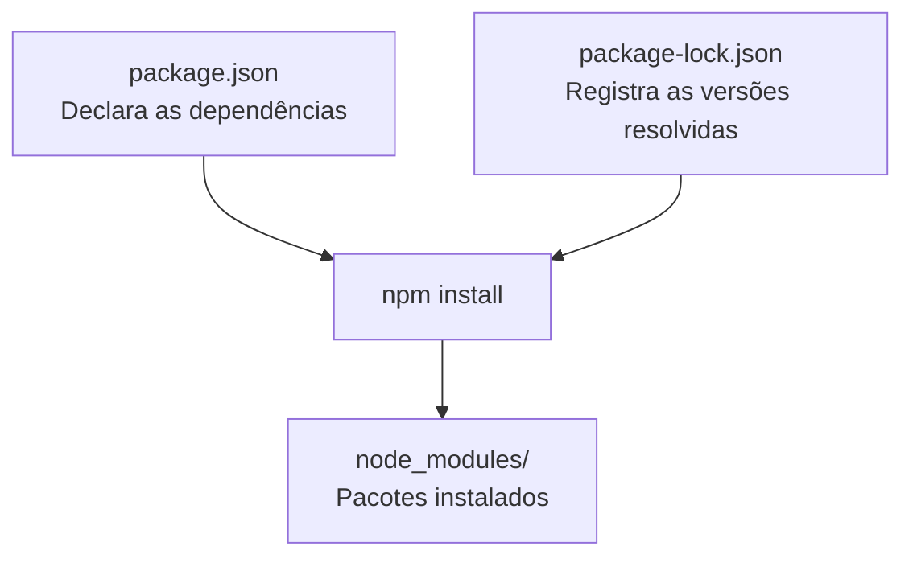

# 03 - Node.js e npm

[](../LICENSE)
[](https://github.com/AntonioJavaDeveloper/mastering-typescript/stargazers)
[](https://github.com/AntonioJavaDeveloper/mastering-typescript/network/members)

---

## 🧭 Navegação

📂 [`README principal do repositório`](https://github.com/AntonioJavaDeveloper/mastering-typescript/blob/main/README.pt-BR.md)  
└── 📁 [`Introdução do capítulo`](./README.pt-BR.md)  
&emsp;&emsp;├── [`01 - JavaScript, ECMAScript, Node.js e Motores JavaScript`](./1-javascript-ecmascript-nodejs-e-motores.pt-BR.md)  
&emsp;&emsp;├── [`02 - TypeScript e Verificação de Tipos`](./2-o-que-e-typescript-e-verificacao-de-tipos.pt-BR.md)  
&emsp;&emsp;├── [`03 - Node.js e npm`](./3-nodejs-e-npm.pt-BR.md) ← **você está aqui**  
&emsp;&emsp;├── [`04 - package.json e package-lock.json`](./4-package-json-e-package-lock.pt-BR.md)  
&emsp;&emsp;├── [`05 - Instalação e Gerenciamento de Dependências`](./5-instalacao-e-gerenciamento-de-dependencias.pt-BR.md)  
&emsp;&emsp;├── [`06 - TypeScript e Execução com tsc e tsx`](./6-typescript-e-execucao-com-tsc-e-tsx.pt-BR.md)  
&emsp;&emsp;├── [`07 - tsconfig.json: Configuração e Seleção de Arquivos`](./7-tsconfig-e-selecao-de-arquivos.pt-BR.md)  
&emsp;&emsp;├── [`08 - tsc: Argumentos, Arquivos e Projetos`](./8-tsc-argumentos-e-compilacao-de-projetos.pt-BR.md)  
&emsp;&emsp;└── [`09 - Verificação de Tipos e Execução Controlada`](./9-verificacao-de-tipos-e-execucao-controlada.pt-BR.md)

---

## 🎯 Introdução

Nos documentos anteriores, estudamos JavaScript, o ambiente de execução Node.js e a linguagem TypeScript. Também vimos que o TypeScript permite analisar tipos e gerar código JavaScript.

Agora, vamos conhecer melhor duas ferramentas fundamentais para trabalhar com projetos desse ecossistema: **Node.js e npm**.

Embora estejam relacionados, eles possuem responsabilidades diferentes. O Node.js permite executar JavaScript fora do navegador, enquanto o npm facilita a instalação e o gerenciamento dos pacotes utilizados por um projeto.

Esses conceitos são importantes para compreender a estrutura atual do nosso repositório `mastering-typescript`, principalmente os arquivos `package.json` e `package-lock.json` e o diretório `node_modules`.

## 🟢 O que é o Node.js?

O [Node.js](https://nodejs.org/) é um ambiente de execução JavaScript que permite executar código JavaScript fora do navegador.

Tradicionalmente, o JavaScript era associado principalmente aos navegadores, onde é executado por um motor JavaScript integrado ao ambiente do navegador. O Node.js permite utilizar JavaScript também em aplicações de servidor, ferramentas de desenvolvimento, scripts e outras aplicações.

Ele utiliza o motor JavaScript V8, o mesmo motor associado ao navegador Google Chrome, e disponibiliza APIs próprias para operações como acesso a arquivos, comunicação de rede e interação com o sistema operacional.

### 🧩 Qual é a relação entre Node.js e TypeScript?

O Node.js executa JavaScript. Já o TypeScript acrescenta recursos à linguagem, como a verificação estática de tipos, que não fazem parte da sintaxe padrão do JavaScript.

Por isso, trabalhar com TypeScript envolve ferramentas que permitem verificar e transformar o código para que ele possa ser executado de maneira compatível com o ambiente escolhido.

No nosso projeto, o Node.js também é necessário para executar ferramentas de desenvolvimento instaladas pelo npm.

Não precisamos aprofundar agora como cada ferramenta funciona. O objetivo deste documento é entender o papel de cada componente.

## 📦 O que é o npm?

O npm é o principal gerenciador de pacotes do ecossistema Node.js. Seu nome é historicamente associado a *Node Package Manager*.

Ele permite instalar, atualizar e remover pacotes, além de ajudar a controlar as dependências utilizadas por um projeto.

Um pacote pode disponibilizar uma biblioteca, uma ferramenta de desenvolvimento ou funcionalidades que podem ser reutilizadas por outras aplicações.

Por exemplo, no nosso repositório, utilizamos pacotes relacionados ao TypeScript e à execução de código durante o desenvolvimento.

### 🔎 Node.js e npm são a mesma coisa?

Não. Embora trabalhem juntos, possuem responsabilidades diferentes.

| Componente | Responsabilidade |
|---|---|
| **Node.js** | Ambiente de execução para JavaScript fora do navegador. |
| **npm** | Gerenciador de pacotes e dependências do projeto. |
| **Pacote** | Código e recursos distribuídos para instalação e reutilização. |

O Node.js fornece o ambiente de execução. O npm ajuda a organizar e instalar as ferramentas e bibliotecas que utilizamos nesse ambiente.

## 🧱 O que é um gerenciador de pacotes?

Um gerenciador de pacotes é uma ferramenta que facilita o uso de código distribuído em pacotes, evitando que cada projeto precise desenvolver do zero todas as funcionalidades de que necessita.

Imagine que nosso projeto precise de uma ferramenta para verificar os tipos do TypeScript. Em vez de desenvolver essa ferramenta, podemos adicionar o pacote correspondente como dependência do projeto.

O gerenciador de pacotes cuida de tarefas como:

- Instalar os pacotes necessários.
- Resolver dependências entre pacotes.
- Registrar as dependências declaradas pelo projeto.
- Controlar versões e, quando aplicável, manter um registro das versões resolvidas.
- Executar scripts definidos pelo projeto.

Essas responsabilidades tornam o gerenciamento de dependências mais organizado e ajudam a reproduzir o ambiente de desenvolvimento em outras máquinas.

## 🗂️ Como isso funciona no nosso projeto?

No repositório `mastering-typescript`, já temos um ambiente de desenvolvimento configurado com Node.js, npm e os pacotes necessários para estudar TypeScript.

Entre os arquivos e diretórios importantes estão:

```text
mastering-typescript/
├── package.json
├── package-lock.json
├── node_modules/
├── src/
└── docs/
```

Cada elemento tem uma finalidade específica.

### 📄 `package.json`: a declaração do projeto

O arquivo `package.json` contém informações sobre o projeto e pode declarar suas dependências, scripts e outros metadados.

No nosso caso, ele registra os pacotes utilizados para estudar TypeScript. Entre as dependências de desenvolvimento que instalamos estão `typescript` e `tsx`.

Um recorte dos campos relevantes para o nosso projeto é:

```json
{
  "name": "mastering-typescript",
  "version": "1.0.0",
  "devDependencies": {
    "tsx": "^4.20.6",
    "typescript": "7.0.2"
  }
}
```

Este exemplo destaca as informações relevantes para o estudo. Consulte o `package.json` do repositório para conferir o conteúdo completo, incluindo os demais campos existentes.

Observe a propriedade `devDependencies`. Ela registra pacotes utilizados durante o desenvolvimento, como ferramentas de compilação, verificação ou execução de código.

O arquivo `package.json` funciona como uma declaração das necessidades do projeto. Ele permite que o npm saiba quais pacotes devem ser instalados e quais scripts ou configurações foram definidos.

### 🔒 `package-lock.json`: o registro das versões resolvidas

O `package-lock.json` complementa o `package.json`.

Enquanto o `package.json` declara as dependências do projeto, o arquivo de lock registra a árvore de dependências resolvida, incluindo as versões exatas dos pacotes instalados e informações sobre suas dependências transitivas.

Uma dependência transitiva é um pacote necessário para que outro pacote funcione. Portanto, mesmo que nosso projeto declare apenas algumas dependências diretamente, a instalação pode envolver muitos outros pacotes.

Esse registro ajuda a reproduzir instalações consistentes em diferentes ambientes.

Em geral, quando o npm instala ou atualiza dependências, ele pode atualizar o `package-lock.json` conforme as mudanças realizadas.

**Não confunda os dois arquivos:**

| Arquivo | Finalidade |
|---|---|
| `package.json` | Declara as dependências diretas e outras informações do projeto. |
| `package-lock.json` | Registra a árvore de dependências resolvida e suas versões, favorecendo instalações reproduzíveis. |

Os dois arquivos são importantes para o versionamento do projeto. Em um repositório Git, normalmente mantemos ambos sob controle de versão.

### 📁 `node_modules`: onde ficam os pacotes instalados

O diretório `node_modules` é onde o npm normalmente instala os pacotes e suas dependências para uso local no projeto.

Depois de uma instalação, podemos encontrar nele os arquivos dos pacotes declarados diretamente e os de outros pacotes necessários para que funcionem.

No nosso projeto, é nesse diretório que ficam instaladas as ferramentas que adicionamos como dependências de desenvolvimento, como `typescript` e `tsx`, além de suas dependências.

O diretório pode conter muitos arquivos e subdiretórios. Por isso, **normalmente não versionamos `node_modules` no Git**. Em vez disso, compartilhamos os arquivos de declaração e de lock, permitindo que cada ambiente instale os pacotes necessários.

### 🔗 Como os três elementos se relacionam?

O fluxo simplificado é:



O `npm install` utiliza as declarações do projeto e, quando disponível e compatível, as informações do arquivo de lock para instalar as dependências em `node_modules`.

Assim, os arquivos versionados descrevem o que o projeto precisa e como as dependências foram resolvidas, enquanto `node_modules` contém os pacotes instalados localmente.

Esse modelo facilita a colaboração: outro desenvolvedor pode obter o repositório e instalar as dependências sem precisar receber uma cópia de todo o diretório `node_modules`.

## 📚 Leitura complementar

Para aprofundar os conceitos apresentados, consulte a documentação oficial:

- 📘 [Node.js — Documentação oficial](https://nodejs.org/docs/latest/api/)
- 📦 [npm — Documentação oficial](https://docs.npmjs.com/)
- 📄 [npm — Sobre o arquivo `package.json`](https://docs.npmjs.com/cli/v11/configuring-npm/package-json)
- 🔒 [npm — Sobre o arquivo `package-lock.json`](https://docs.npmjs.com/cli/v11/configuring-npm/package-lock-json)

---

## 📬 Contribuições

Se este projeto te ajudou ou inspirou, considere deixar uma estrela ⭐ no repositório!

Sinta-se à vontade para abrir *issues* com sugestões, correções ou dúvidas. Este repositório é um espaço voltado à **evolução constante** e à consolidação de boas práticas no desenvolvimento de software com TypeScript.

Toda colaboração construtiva será analisada com atenção.

---

## 🔗 Navegação Rápida

⬅️ Retornar à [`02 - TypeScript e Verificação de Tipos`](./2-o-que-e-typescript-e-verificacao-de-tipos.pt-BR.md)

➡️ Avançar para [`04 - package.json e package-lock.json`](./4-package-json-e-package-lock.pt-BR.md)

🏠 Retornar ao [`README principal do repositório`](https://github.com/AntonioJavaDeveloper/mastering-typescript/blob/main/README.pt-BR.md)

---

## 📫 Contato

Caso queira trocar experiências sobre desenvolvimento de software, arquitetura de aplicações, Java, TypeScript ou tecnologia em geral, você pode me encontrar através dos canais abaixo:

- 🌐 [javadeveloper.com.br](https://javadeveloper.com.br/)
- 💼 [LinkedIn](https://www.linkedin.com/in/antonio-javadeveloper/)
- 📧 [antonio@javadeveloper.com.br](mailto:antonio@javadeveloper.com.br)

> Developed by [AntonioJavaDeveloper](https://github.com/AntonioJavaDeveloper)
