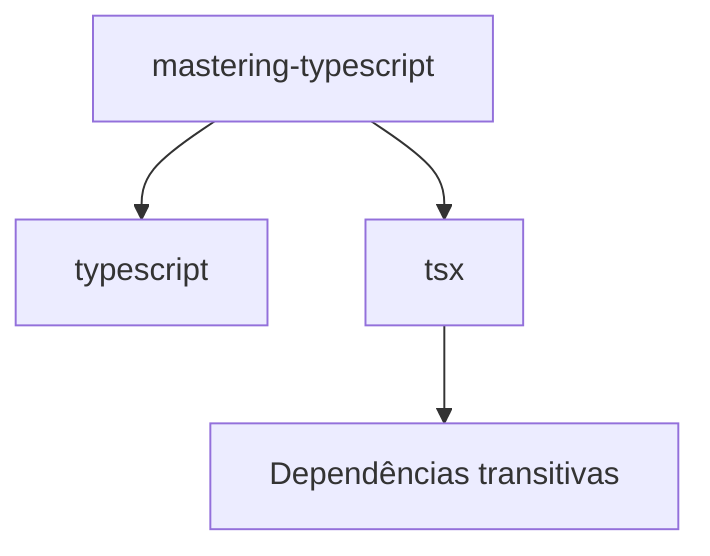
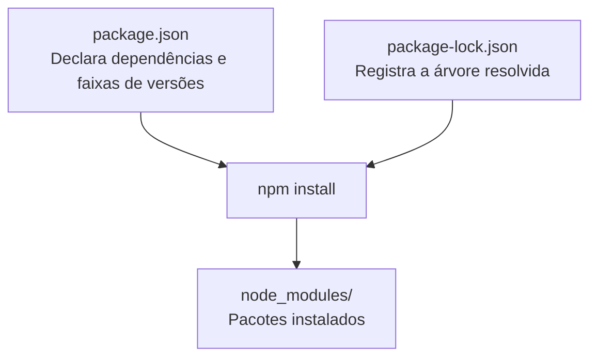

# 04 - Gerenciamento de Dependências com npm

[](../LICENSE)
[](https://github.com/AntonioJavaDeveloper/mastering-typescript/stargazers)
[](https://github.com/AntonioJavaDeveloper/mastering-typescript/network/members)

---

## 🧭 Navegação

📂 [`README principal do repositório`](https://github.com/AntonioJavaDeveloper/mastering-typescript/blob/main/README.pt-BR.md)  
└── 📁 [`Introdução do capítulo`](./README.pt-BR.md)  
&emsp;&emsp;├── [`01 - JavaScript, ECMAScript, Node.js e Motores JavaScript`](./1-javascript-ecmascript-nodejs-e-motores.pt-BR.md)  
&emsp;&emsp;├── [`02 - TypeScript e Verificação de Tipos`](./2-o-que-e-typescript-e-verificacao-de-tipos.pt-BR.md)  
&emsp;&emsp;├── [`03 - Node.js e npm`](./3-nodejs-e-npm.pt-BR.md)  
&emsp;&emsp;└── [`04 - Gerenciamento de Dependências com npm`](./4-package-json-e-package-lock.pt-BR.md) ← **você está aqui**  
&emsp;&emsp;├── [`05 - Instalação e Gerenciamento de Dependências`](./5-instalacao-e-gerenciamento-de-dependencias.pt-BR.md)  
&emsp;&emsp;├── [`06 - TypeScript e Execução com tsc e tsx`](./6-typescript-e-execucao-com-tsc-e-tsx.pt-BR.md)  
&emsp;&emsp;├── [`07 - tsconfig.json: Configuração e Seleção de Arquivos`](./7-tsconfig-e-selecao-de-arquivos.pt-BR.md)  
&emsp;&emsp;├── [`08 - tsc: Argumentos, Arquivos e Projetos`](./8-tsc-argumentos-e-compilacao-de-projetos.pt-BR.md)  
&emsp;&emsp;└── [`09 - Verificação de Tipos e Execução Controlada`](./9-verificacao-de-tipos-e-execucao-controlada.pt-BR.md)

---

## 🎯 Introdução

No documento anterior, conhecemos o Node.js, o npm e o conceito de gerenciamento de pacotes. Agora vamos entender como um projeto registra as dependências de que precisa e como essas informações ajudam a manter o ambiente de desenvolvimento organizado.

Para isso, vamos utilizar os próprios arquivos do repositório `mastering-typescript`:

- `package.json`: declara as dependências diretas e contém informações e configurações do projeto.
- `package-lock.json`: registra a árvore de dependências resolvida, incluindo as versões exatas dos pacotes instalados.
- `node_modules/`: diretório no qual o npm instala os pacotes para uso local.

Esses elementos trabalham em conjunto, mas possuem responsabilidades diferentes. Compreender essa distinção é fundamental antes de estudar os comandos de instalação e gerenciamento de dependências.

## 📦 O que são dependências?

Uma dependência é um pacote de que um projeto precisa para executar determinada funcionalidade ou realizar uma tarefa de desenvolvimento.

Em vez de implementar tudo do zero, podemos utilizar pacotes já desenvolvidos e distribuídos pelo ecossistema. Isso permite reutilizar soluções existentes e concentrar nossos esforços no objetivo principal do projeto.

No nosso repositório, por exemplo, utilizamos dois pacotes diretamente relacionados ao estudo do TypeScript:

- **`typescript`**: disponibiliza ferramentas do TypeScript, incluindo o compilador `tsc`.
- **`tsx`**: permite executar arquivos TypeScript utilizando uma ferramenta apropriada para esse fluxo de desenvolvimento.

Esses pacotes estão declarados em `devDependencies` porque são utilizados durante o desenvolvimento do projeto.

### 🔗 Dependências diretas e transitivas

As dependências podem ser classificadas conforme a relação que possuem com o projeto.

**Dependência direta** é um pacote declarado pelo próprio projeto. No nosso caso, `typescript` e `tsx` são dependências diretas.

**Dependência transitiva** é um pacote de que outra dependência precisa para funcionar. Mesmo que não o tenhamos declarado diretamente no `package.json`, ele pode ser instalado por ser necessário para algum dos pacotes utilizados.

Podemos representar essa relação de maneira simplificada:



O diagrama ilustra o conceito. A quantidade e a identidade das dependências transitivas efetivamente instaladas dependem da árvore de dependências resolvida.

### 🛠️ Dependências de desenvolvimento e de produção

O npm permite classificar as dependências conforme sua finalidade.

| Campo | Finalidade |
|---|---|
| `dependencies` | Pacotes necessários à aplicação em seu ambiente de execução, conforme a arquitetura do projeto. |
| `devDependencies` | Pacotes utilizados no desenvolvimento, nos testes, na compilação ou em outras tarefas de engenharia de software. |

Essa separação é especialmente útil em aplicações que serão implantadas em produção.

No nosso repositório de estudos, `typescript` e `tsx` estão em `devDependencies`, pois são ferramentas utilizadas para estudar, verificar e executar os exemplos durante o desenvolvimento.

Isso não significa que todo pacote usado por uma aplicação TypeScript deva estar em `devDependencies`. A classificação depende da função que ele exerce no projeto. 

Um desenvolvedor escreve código utilizando a sintaxe TypeScript. Entretanto, após a compilação, o que é efetivamente executado pelo navegador ou pelo servidor são arquivos JavaScript.

Dessa forma, o TypeScript é uma dependência importante durante o desenvolvimento, pois participa da análise de tipos e do processo de compilação do projeto. Em contrapartida, em muitos cenários de produção, os arquivos TypeScript já foram convertidos para JavaScript e não são mais necessários para a execução da aplicação.

Por esse motivo, é comum que o pacote `typescript` seja adicionado à seção `devDependencies` do `package.json`.

Pelo mesmo motivo, o pacote `tsx` também pode ser classificado como uma dependência de desenvolvimento, já que ele é utilizado para executar exemplos e auxiliar o programador durante os estudos e o desenvolvimento da aplicação.

## 📄 O arquivo `package.json`

O `package.json` é um arquivo de metadados e configuração do projeto Node.js. Nele, podemos declarar informações como nome, versão, scripts e dependências.

Este é o conteúdo do `package.json` presente no repositório:

```json
{
  "name": "mastering-typescript",
  "version": "1.0.0",
  "description": "",
  "main": "index.js",
  "scripts": {
    "test": "echo \"Error: no test specified\" && exit 1"
  },
  "repository": {
    "type": "git",
    "url": "git+https://github.com/AntonioJavaDeveloper/mastering-typescript.git"
  },
  "keywords": [],
  "author": "",
  "license": "ISC",
  "bugs": {
    "url": "https://github.com/AntonioJavaDeveloper/mastering-typescript/issues"
  },
  "homepage": "https://github.com/AntonioJavaDeveloper/mastering-typescript#readme",
  "devDependencies": {
    "tsx": "^4.20.6",
    "typescript": "^7.0.2"
  }
}
```

Vamos destacar os campos mais importantes para compreender o funcionamento do projeto.

### 🏷️ Metadados do projeto

As propriedades `name` e `version` identificam o pacote e sua versão declarada. Outros campos, como `description`, `author`, `repository` e `homepage`, fornecem informações adicionais.

Esses metadados ajudam a identificar e descrever o projeto, mas não são todos obrigatórios para que um projeto local utilize dependências.

### 🧰 A seção `devDependencies`

Observe este trecho do nosso arquivo:

```json
"devDependencies": {
  "tsx": "^4.20.6",
  "typescript": "^7.0.2"
}
```

Ele declara dois pacotes utilizados durante o desenvolvimento.

Cada propriedade associa o nome de um pacote a uma especificação de versão. Essa especificação não precisa representar uma única versão exata: ela pode permitir uma faixa de versões compatíveis.

Por exemplo, `^4.20.6` não significa que o projeto necessariamente instalou a versão `4.20.6`. Significa que a declaração permite versões compatíveis dentro dos limites definidos pelo operador `^`.

Veremos essa diferença ao comparar o `package.json` com o `package-lock.json`.

### ▶️ A seção `scripts`

O `package.json` também pode definir comandos personalizados para tarefas do projeto.

No nosso arquivo, existe esta seção:

```json
"scripts": {
  "test": "echo \"Error: no test specified\" && exit 1",
  "check": "tsc --noEmit",
  "dev": "tsx",
  "start": "tsc --noEmit && tsx"  
}
```

O script chamado `test` contém um comando de terminal. Em breve saberemos como invocar `test`. E quando ele for invocado sera executado o seguinte script `echo "Error: no test specified" && exit 1`.

Ele imprime a mensagem `Error: no test specified` e termina com um código de saída diferente de zero, indicando falha.

Os scripts podem ser executados por meio do npm. Por exemplo:

```bash
npm test
```
ou de forma abreviada:

```bash
npm test
```

Esse comando executa o script `test` que está definido no nosso `package.json`. Como o script atual é apenas um marcador padrão, ele não executa uma suíte de testes real.

Também podemos criar scripts com nomes como `check`, `dev` ou `start`, desde que definamos o comando correspondente na seção `scripts`. Depois, podemos executá-los com comandos como `npm run check`, `npm run dev` ou `npm run start`.

A seção `scripts` funciona, portanto, como uma forma de padronizar tarefas do projeto, evitando que todos precisem memorizar comandos longos ou diferentes. Vejamos os outros marcadores de script: 

### ✅ Executando o script `check`

Ao executar:

```bash
npm run check
```

o npm procura o script chamado `check` dentro do `package.json`:

```json
"check": "tsc --noEmit"
```

e executa o comando associado:

```bash
tsc --noEmit
```

Estando no terminal, o resposável de alcançar o compilador `tsc`, procurando no meio das nossas dependências, é o comando `npx`. Então, no terminal, o comando `tsc --noEmit` é plenamente alcançado através do comando:

```bash
npx tsc --noEmit
```

Já estudamos que o `npx` (*Node Package Execute*) é um executor de pacotes do ecosistema `Node.js`. Enquanto o `npm` serve para gerenciar, instalar e remover bibliotecas ou dependências (locais ou globais), o `npx` serve para rodar pacotes sem a necessidade de instalá-los de forma permanente no computador.

Para o nosso arquivo `package.json` executar

```bash
npm run check
```

equivale executar:

```bash
npx tsc --noEmit
```

### 💻 Executando o script `dev`

Considere o script:

```json
"dev": "tsx"
```

Ao executar:

```bash
npm run dev -- src/02-typescript-environment-and-dependencies/Pessoa.ts
```

o trecho informado após o `--` é encaminhado como argumento para o script.

Na prática, o comando executado é equivalente a:

```bash
tsx src/02-typescript-environment-and-dependencies/Pessoa.ts
```

Uma forma de visualizar mentalmente esse processo é imaginar algo semelhante a:

```bash
npx tsx src/02-typescript-environment-and-dependencies/Pessoa.ts
```

O objetivo dessa comparação é apenas demonstrar que o executável `tsx` é localizado automaticamente entre as dependências instaladas do projeto.

### 🟩 Executando o script `start`

Agora observe o script:

```json
"start": "tsc --noEmit && tsx"
```

Quando executamos:

```bash
npm run start -- src/02-typescript-environment-and-dependencies/Pessoa.ts
```

o argumento fornecido após o `--` também é repassado ao script.

O resultado prático é equivalente a:

```bash
tsc --noEmit && tsx src/02-typescript-environment-and-dependencies/Pessoa.ts
```

Primeiramente é executado:

```bash
tsc --noEmit
```

Caso nenhuma inconsistência de tipos seja encontrada, o operador `&&` permite a execução do próximo comando:

```bash
tsx src/02-typescript-environment-and-dependencies/Pessoa.ts
```

Para fins didáticos, podemos imaginar algo semelhante a:

```bash
npx tsc --noEmit && npx tsx src/02-typescript-environment-and-dependencies/Pessoa.ts
```

Isso ajuda a visualizar que tanto o `tsc` quanto o `tsx` são executáveis disponibilizados pelas dependências instaladas no projeto.

Além disso, esse script combina duas tarefas comuns: primeiro verifica possíveis erros de tipagem e, somente se essa verificação for concluída com sucesso, executa o arquivo TypeScript informado.

Nesse momento já começamos a responder a pergunta feita lá no começo. Já sabemos qual o comando que devemos utilizar para preservar a consistência do nosso projeto evitando a transpilação quando tem algum erro. Já sabemos realizar essa tarefa utilizando o comando `npx tsc --noEmit && npx tsx seuArquivo.ts`. Também sabemos evitar a transpilação se houver algum erro de checagem estática utilizando esse script como parte integrante do nosso arquivo `package.json` na seção de `scripts`.

Mas ainda não sabemos como configurar o comando `npx tsc --noEmit`, através do arquivo `tsconfig.json`, para que possa ser checado todo nosso projeto de forma a manter a consistência do projeto. Veremos esse e outros assuntos mais adiante ainda nesse capítulo.

## 🔒 O arquivo `package-lock.json`

O `package-lock.json` é criado e mantido pelo npm para registrar a árvore de dependências resolvida para o projeto.

Ele contém informações como as versões exatas dos pacotes, suas origens e os relacionamentos necessários para instalar a árvore de dependências. Isso ajuda a obter instalações consistentes entre diferentes ambientes.

O arquivo complementa o `package.json`: enquanto este declara as dependências diretas e as faixas de versões permitidas, o lock registra a resolução concreta utilizada pelo npm.

### 🔍 Comparando a versão declarada com a versão resolvida

Vamos utilizar um exemplo real dos arquivos que você compartilhou.

No `package.json`, temos:

```json
"tsx": "^4.20.6"
```

Já no trecho do `package-lock.json`, temos:

```json
"node_modules/tsx": {
  "version": "4.23.15",
  "resolved": "https://registry.npmjs.org/tsx/-/tsx-4.23.15.tgz"
}
```

Observe a diferença:

| Arquivo | Informação registrada |
|---|---|
| `package.json` | `^4.20.6` — especificação que permite uma faixa de versões compatíveis. |
| `package-lock.json` | `4.23.15` — versão exata registrada para esse pacote na árvore resolvida. |

Não existe contradição entre esses valores. A versão `4.23.15` satisfaz a faixa permitida por `^4.20.6`.

O operador `^` permite atualizações compatíveis sem exigir que o projeto permaneça na versão inicialmente declarada. Para uma versão inicial `4.20.6`, ele permite versões a partir de `4.20.6` e inferiores a `5.0.0`.

Quando o lock registra `4.23.15`, ele informa qual versão foi resolvida para essa instalação. Em condições normais, uma instalação que respeite o lockfile pode reproduzir essa versão, em vez de escolher novamente qualquer versão permitida pela faixa.

É importante entender que **o `package.json` não é um registro da versão exata que está instalada**. Para essa informação, consultamos o `package-lock.json` e, quando necessário, verificamos o que está efetivamente instalado.

### 🔢 O que significam os símbolos de versão?

O npm utiliza especificações de versão para indicar quais versões de um pacote podem ser aceitas. Alguns operadores comuns são:

| Especificação | Significado geral | Exemplo |
|---|---|---|
| `^4.20.6` | Permite atualizações compatíveis dentro da faixa iniciada em `4.20.6`, sem chegar a `5.0.0`. | `4.23.15` é permitida. |
| `~4.20.6` | Permite atualizações de patch dentro da série `4.20`, a partir de `4.20.6`. | `4.20.7` é permitida; `4.21.0` não. |
| `4.20.6` | Especifica somente essa versão. | Apenas `4.20.6`. |
| `>=4.20.6` | Permite versões iguais ou superiores à indicada, sem limite superior explícito. | `4.23.15` e `5.0.0` são permitidas. |
| `>4.20.6` | Permite versões superiores à indicada. | `4.20.7` é permitida; `4.20.6` não. |
| `<5.0.0` | Permite versões inferiores à indicada. | `4.23.15` é permitida; `5.0.0` não. |
| `4.x` | Permite versões da linha principal `4`, conforme as regras de versionamento semântico. | `4.20.6` e `4.23.15` são permitidas. |

Esses exemplos apresentam as regras gerais para versões estáveis. A interpretação exata depende da especificação completa, especialmente em casos de versões iniciais `0.x` e versões de pré-lançamento.

#### 💡 Uma observação sobre o operador `^`

O comportamento de `^` depende da versão inicial declarada.

Em versões principais iguais ou superiores a `1`, como `^4.20.6`, ele permite atualizações que não alterem a versão principal. Para versões iniciais `0.x`, as regras são mais restritivas, porque mudanças incompatíveis podem ocorrer antes da versão `1.0.0`.

Por exemplo:

- `^4.20.6`: permite versões a partir de `4.20.6` e inferiores a `5.0.0`.
- `^0.2.3`: permite versões a partir de `0.2.3` e inferiores a `0.3.0`.
- `^0.0.3`: permite versões a partir de `0.0.3` e inferiores a `0.0.4`.

Esses limites explicam por que não devemos interpretar `^` simplesmente como “qualquer versão mais nova”.

### 🔁 Por que manter o `package-lock.json`?

Imagine que duas pessoas clonem o mesmo repositório em computadores diferentes. O `package.json` declara as dependências, mas, sem um lockfile, o npm pode resolver versões diferentes em momentos diferentes, desde que elas respeitem as faixas declaradas.

O `package-lock.json` registra a resolução escolhida e ajuda a manter as instalações consistentes.

Por isso, em projetos que utilizam npm, normalmente versionamos tanto o `package.json` quanto o `package-lock.json` no Git.

O lockfile também pode ser atualizado quando as dependências são alteradas. Portanto, ele deve acompanhar as mudanças legítimas na árvore de dependências, e não ser editado manualmente como se fosse apenas uma lista de versões.

## 🗃️ E onde entra o `node_modules`?

O diretório `node_modules` contém os pacotes que o npm instalou localmente, incluindo as dependências diretas e transitivas.

No nosso projeto, é nesse diretório que ficam os arquivos das versões instaladas de `tsx`, `typescript` e dos pacotes necessários para seu funcionamento.

Os três elementos se complementam:



O `npm install` utiliza as declarações do projeto e, quando o lockfile está presente e compatível, utiliza suas informações para orientar a instalação.

Normalmente, não versionamos `node_modules` no Git, pois ele pode ser reconstruído a partir dos arquivos de configuração e do lockfile. Isso evita adicionar milhares de arquivos gerados ao repositório.

Em resumo:

- `package.json`: declara o que o projeto precisa.
- `package-lock.json`: registra como a árvore de dependências foi resolvida.
- `node_modules`: contém os pacotes instalados para uso local.

## 📚 Leitura complementar

Para aprofundar os conceitos apresentados, consulte a documentação oficial:

- 📘 [Node.js — Documentação oficial](https://nodejs.org/docs/latest/api/)
- 📦 [npm — Documentação oficial](https://docs.npmjs.com/)
- 📄 [npm — Sobre o arquivo `package.json`](https://docs.npmjs.com/cli/v11/configuring-npm/package-json)
- 🔒 [npm — Sobre o arquivo `package-lock.json`](https://docs.npmjs.com/cli/v11/configuring-npm/package-lock-json)
- 🔢 [Node.js — Versionamento semântico](https://nodejs.org/en/about/previous-releases)

---

## 📬 Contribuições

Se este projeto te ajudou ou inspirou, considere deixar uma estrela ⭐ no repositório!

Sinta-se à vontade para abrir *issues* com sugestões, correções ou dúvidas. Este repositório é um espaço voltado à **evolução constante** e à consolidação de boas práticas no desenvolvimento de software com TypeScript.

Toda colaboração construtiva será analisada com atenção.

---

## 🔗 Navegação Rápida

⬅️ Retornar à [`03 - Node.js e npm`](./3-nodejs-e-npm.pt-BR.md)

➡️ Avançar para [`05 - Instalação e Gerenciamento de Dependências`](./5-instalacao-e-gerenciamento-de-dependencias.pt-BR.md)

🏠 Retornar ao [`README principal do repositório`](https://github.com/AntonioJavaDeveloper/mastering-typescript/blob/main/README.pt-BR.md)

---

## 📫 Contato

Caso queira trocar experiências sobre desenvolvimento de software, arquitetura de aplicações, Java, TypeScript ou tecnologia em geral, você pode me encontrar através dos canais abaixo:

- 🌐 [javadeveloper.com.br](https://javadeveloper.com.br/)
- 💼 [LinkedIn](https://www.linkedin.com/in/antonio-javadeveloper/)
- 📧 [antonio@javadeveloper.com.br](mailto:antonio@javadeveloper.com.br)

> Developed by [AntonioJavaDeveloper](https://github.com/AntonioJavaDeveloper)
