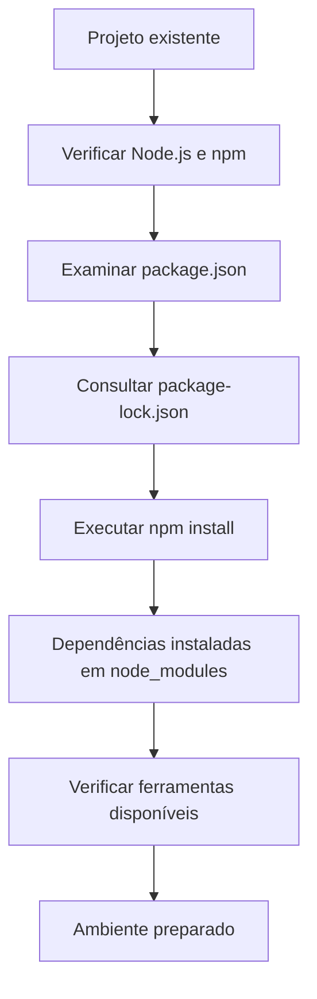
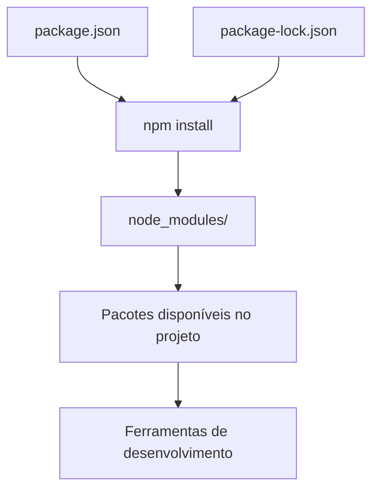

# 05 - Instalação e Gerenciamento de Dependências

[](../LICENSE)
[](https://github.com/AntonioJavaDeveloper/mastering-typescript/stargazers)
[](https://github.com/AntonioJavaDeveloper/mastering-typescript/network/members)

---

## 🧭 Navegação

📂 [`README principal do repositório`](https://github.com/AntonioJavaDeveloper/mastering-typescript/blob/main/README.pt-BR.md)  
└── 📁 [`Introdução do capítulo`](./README.pt-BR.md)  
&emsp;&emsp;├── [`01 - JavaScript, ECMAScript, Node.js e Motores JavaScript`](./1-javascript-ecmascript-nodejs-e-motores.pt-BR.md)  
&emsp;&emsp;├── [`02 - TypeScript e Verificação de Tipos`](./2-o-que-e-typescript-e-verificacao-de-tipos.pt-BR.md)  
&emsp;&emsp;├── [`03 - Node.js e npm`](./3-nodejs-e-npm.pt-BR.md)  
&emsp;&emsp;├── [`04 - Gerenciamento de Dependências com npm`](./4-package-json-e-package-lock.pt-BR.md)  
&emsp;&emsp;├── [`05 - Instalação e Gerenciamento de Dependências`](./5-instalacao-e-gerenciamento-de-dependencias.pt-BR.md) ← **você está aqui**  
&emsp;&emsp;├── [`06 - TypeScript e Execução com tsc e tsx`](./6-typescript-e-execucao-com-tsc-e-tsx.pt-BR.md)  
&emsp;&emsp;├── [`07 - tsconfig.json: Configuração e Seleção de Arquivos`](./7-tsconfig-e-selecao-de-arquivos.pt-BR.md)  
&emsp;&emsp;├── [`08 - tsc: Argumentos, Arquivos e Projetos`](./8-tsc-argumentos-e-compilacao-de-projetos.pt-BR.md)  
&emsp;&emsp;└── [`09 - Verificação de Tipos e Execução Controlada`](./9-verificacao-de-tipos-e-execucao-controlada.pt-BR.md)

---

## 🎯 Introdução

📌 **Objetivo:** compreender como instalar, adicionar, remover e atualizar dependências com npm, preparando o ambiente de desenvolvimento a partir dos arquivos já existentes em um projeto.

Um projeto de software raramente depende apenas do código escrito por seus próprios desenvolvedores. Muitas aplicações utilizam pacotes externos para executar tarefas como testes automatizados, análise de código, compilação e execução durante o desenvolvimento.

O **npm** permite gerenciar esses pacotes, facilitando a preparação do ambiente e a manutenção das dependências utilizadas pelo projeto.

Nos documentos anteriores, foram apresentados o Node.js, o npm, o arquivo `package.json` e o arquivo `package-lock.json`. Agora, o foco passa a ser a utilização prática dos comandos necessários para trabalhar com essas ferramentas.

### 🏷️ O que será aprendido?

- Como verificar a instalação do Node.js e do npm.
- Como utilizar `npm install` e sua forma abreviada `npm i`.
- Como diferenciar a instalação das dependências existentes da adição de novos pacotes.
- Quais são as diferenças entre dependências locais e globais.
- Como instalar as dependências de um projeto existente.
- Como localizar os executáveis disponibilizados pelos pacotes instalados.
- Como consultar comandos de remoção, atualização e inicialização de projetos.

### 🗺️ Visão geral do processo

O fluxo abaixo representa o procedimento habitual para preparar um projeto existente.



> 💡 **Conceito importante:** instalar as dependências de um projeto existente não é a mesma coisa que criar um projeto novo ou adicionar um pacote. Cada operação tem uma finalidade específica.

---

## 🧰 Preparação do ambiente


Antes de executar os comandos de instalação, é necessário verificar se o ambiente disponibiliza as ferramentas necessárias.

### 🔎 Verificando o Node.js

O comando abaixo exibe a versão do Node.js instalada:

```bash
node -v
```

Exemplo de saída:

```text
v22.23.3
```

A versão apresentada é apenas ilustrativa. O resultado depende da instalação disponível no ambiente.

### 📦 Verificando o npm

O comando abaixo exibe a versão do npm:

```bash
npm -v
```

Exemplo de saída:

```text
10.9.9
```

O npm normalmente é instalado junto com o Node.js. Entretanto, a versão do gerenciador de pacotes pode variar conforme a distribuição e a instalação utilizadas.

> ⚠️ **Atenção:** os números apresentados são exemplos, não requisitos fixos deste capítulo. O ambiente deve utilizar versões compatíveis com as necessidades do projeto.

### 📂 Entrando no diretório do projeto

Antes de instalar as dependências, é necessário acessar o diretório que contém o arquivo `package.json`.

```bash
cd /caminho/do/projeto
```

O caminho acima é ilustrativo. O pacakge.json se encontra na raiz do projeto. O caminho acima deve ser substituído pelo diretório real do seu projeto.

Para conferir os arquivos existentes, pode-se utilizar em ambientes Linux:

```bash
ls -la
```

Em um projeto Node.js, é comum encontrar arquivos como:

```text
package.json
package-lock.json
tsconfig.json
src/
```

Não se preocupe, ainda não criamos nosso arquivo `tsconfig.json`. A presença de cada arquivo depende da configuração do projeto.

---

## 📥 Instalação de dependências com npm


O comando `npm install` possui comportamentos diferentes conforme os argumentos informados. Compreender essa diferença evita instalações desnecessárias e alterações acidentais nas dependências do projeto.

### 📦 Instalando as dependências existentes

```bash
npm install
```

Quando executado no diretório de um projeto que possui `package.json`, esse comando instala as dependências declaradas no projeto e resolve a árvore de pacotes conforme as regras do npm e os arquivos disponíveis.

Se houver um `package-lock.json` compatível com o `package.json`, o npm utiliza as informações do arquivo de bloqueio para orientar a resolução das versões.

Esse procedimento é especialmente útil quando um projeto é clonado do GitHub ou obtido de outra pessoa.

**Exemplo de situação:**

Um desenvolvedor disponibiliza um repositório contendo o código-fonte e os arquivos que descrevem suas dependências. Após obter o projeto, outro desenvolvedor executa `npm install` para preparar o ambiente local.

O npm instala os pacotes necessários sem exigir que cada dependência seja adicionada manualmente.

### ➕ Instalando um pacote específico

```bash
npm install nome-do-pacote
```

Também é possível utilizar a forma abreviada:

```bash
npm i nome-do-pacote
```

Os dois comandos representam a mesma operação.

Quando um pacote é adicionado a um projeto, o npm normalmente:

- Instala o pacote no projeto.
- Registra a dependência no `package.json`.
- Atualiza o `package-lock.json`, quando aplicável.

O registro ocorre na seção apropriada de acordo com o tipo de instalação e a configuração utilizada.

**Exemplo:**

```bash
npm install typescript
```

Esse comando adiciona o TypeScript como dependência regular do projeto. Para instalá-lo como dependência de desenvolvimento, utiliza-se a opção `-D`, apresentada adiante.

> 💡 **Diferença essencial**
>
> | Comando | Finalidade |
> | --- | --- |
> | `npm install` | Instalar as dependências do projeto existente. Instala as dependências declaradas no arquivo `package.json`|
> | `npm install nome-do-pacote` | Adicionar e instalar um pacote específico. |
> | `npm i nome-do-pacote` | Forma abreviada do comando anterior. |

### 🧪 Instalando dependências de desenvolvimento

```bash
npm install nome-do-pacote --save-dev
```

A forma abreviada é:

```bash
npm install nome-do-pacote -D
```
Ou:

```bash
npm install -D nome-do-pacote
```

Ou:

```bash
npm i -D nome-do-pacote
```

Esses comandos adicionam o pacote à seção `devDependencies` do `package.json`.

As dependências de desenvolvimento são utilizadas em atividades como:

- Compilação e transformação do código.
- Execução de testes automatizados.
- Análise estática e verificação de qualidade.
- Ferramentas de desenvolvimento.

No contexto deste repositório, ferramentas como `typescript` e `tsx` podem ser instaladas como dependências de desenvolvimento.

Exemplo:

```bash
npm install -D typescript tsx
```

O comando instala os dois pacotes e registra suas dependências de desenvolvimento no projeto.

> 📌 **Importante:** a classificação como dependência de desenvolvimento não impede que uma ferramenta seja utilizada durante o desenvolvimento de aplicações destinadas à produção. Ela indica a função do pacote na organização das dependências do projeto.

---

## 🌍 Instalação local e global


Os pacotes npm podem ser instalados localmente em um projeto ou globalmente no ambiente.

A escolha depende de como a ferramenta será utilizada.

### 📁 Instalação local

Por padrão, quando um pacote é instalado em um projeto, ele fica disponível na estrutura local de dependências, geralmente dentro de `node_modules/`.

Exemplo:

```bash
npm install -D typescript
```

A instalação local apresenta algumas vantagens:

- Permite registrar as ferramentas utilizadas pelo projeto.
- Facilita a reprodução do ambiente por outros desenvolvedores.
- Permite utilizar versões específicas das ferramentas.
- Reduz a dependência de instalações globais na máquina.
- Favorece a automação dos comandos em scripts.

É o modelo adotado neste repositório para as ferramentas de desenvolvimento.

### 🌐 Instalação global

Para instalar um pacote globalmente, utiliza-se a opção `-g`:

```bash
npm install -g nome-do-pacote
```

Esse formato disponibiliza a ferramenta no ambiente global do npm, permitindo utilizá-la no terminal sem precisar adicioná-la individualmente a cada projeto.

Entretanto, a disponibilidade do comando depende da configuração do ambiente e do diretório de executáveis globais do npm.

A instalação global pode ser útil para ferramentas que precisam ser acessadas de maneira recorrente em diferentes projetos.

### ⚖️ Comparação entre os modelos

| Característica | Instalação local | Instalação global |
| --- | --- | --- |
| Escopo | Projeto específico | Ambiente do usuário ou sistema |
| Registro no projeto | Normalmente registrado no `package.json` | Não é registrado como dependência local do projeto |
| Controle de versão | Associado às dependências do projeto | Depende da instalação global |
| Reprodução do ambiente | Facilitada pelos arquivos de dependências | Exige atenção à configuração global |
| Uso recomendado neste repositório | Sim | Não como estratégia principal |

> 💡 **Boa prática:** prefira a instalação local para ferramentas das quais o projeto depende. Dessa forma, o repositório documenta as dependências necessárias e facilita a preparação do ambiente em outras máquinas.

---

## 🔄 Reproduzindo o ambiente do projeto


Esta seção reúne o procedimento para preparar um projeto existente, aproveitando os arquivos de configuração e de dependências que já fazem parte do repositório.

### 📄 Entendendo os arquivos utilizados

O `package.json` descreve as dependências diretas, os scripts e outros metadados do projeto.

O `package-lock.json` registra informações detalhadas sobre a árvore de dependências resolvida, contribuindo para que instalações posteriores utilizem versões consistentes.

O diretório `node_modules/` contém os pacotes instalados localmente.

Esses elementos trabalham em conjunto:



### 🚀 Passo a passo da instalação

**Passo 1 — Acessar o projeto**

Entre no diretório que contém o `package.json`.

```bash
cd /caminho/do/projeto
```

**Passo 2 — Conferir os arquivos**

```bash
ls -la
```

Verifique se os arquivos `package.json` e `package-lock.json` estão presentes, quando esperados pela estrutura do projeto.

**Passo 3 — Instalar as dependências**

```bash
npm install
```

Aguarde o término da instalação. O npm poderá apresentar informações sobre pacotes adicionados, avisos ou vulnerabilidades detectadas.

**Passo 4 — Conferir as dependências instaladas**

```bash
npm ls --depth=0
```

O comando apresenta as dependências diretas instaladas no projeto. Ele ajuda a verificar se os pacotes esperados estão disponíveis e a identificar possíveis inconsistências.

**Passo 5 — Verificar os executáveis locais**

Em sistemas Linux e macOS, pode-se consultar o diretório:

```bash
ls node_modules/.bin
```

Esse diretório disponibiliza executáveis associados a diversos pacotes instalados localmente.

No Windows, o diretório também existe, mas a forma de listar seu conteúdo depende do terminal utilizado.

### 🛠️ O que é `node_modules/.bin`?

Quando um pacote disponibiliza comandos executáveis, o npm pode criar entradas correspondentes em `node_modules/.bin`.

Por exemplo, após instalar localmente o TypeScript e o `tsx`, o diretório pode conter comandos como:

```text
node_modules/.bin/
├── tsc
├── tsserver
└── tsx
```

A listagem é ilustrativa e pode variar conforme os pacotes instalados.

O `tsc` é o executável do compilador TypeScript. O `tsx` é uma ferramenta utilizada para executar arquivos TypeScript.

Esses comandos serão explorados com mais profundidade no documento:

[`06 - TypeScript e Execução com tsc e tsx`](./6-typescript-e-execucao-com-tsc-e-tsx.pt-BR.md).

### ⚠️ Cuidados ao preparar um projeto existente

- Não crie um novo `package.json` quando o projeto já possui um arquivo válido que deve ser preservado.
- Não adicione pacotes apenas para testar comandos sem antes compreender seu propósito.
- Evite instalar globalmente ferramentas que já estão declaradas nas dependências do projeto.
- Não confunda a presença de uma pasta `node_modules/` com a garantia de que todas as dependências estejam corretas.
- Antes de atualizar dependências, verifique as regras do projeto e as alterações que poderão ocorrer nos arquivos de bloqueio.

> 🔒 **Atenção ao arquivo de bloqueio:** o `npm install` pode atualizar o `package-lock.json` quando necessário para compatibilizar as dependências declaradas. Se o objetivo for uma instalação automatizada que exija correspondência estrita com o arquivo de bloqueio, existe também o comando `npm ci`, que será abordado quando for pertinente ao fluxo de trabalho.

---


## 🧪 Exercício prático: reconstruindo o ambiente com npm

Até aqui, conhecemos os principais arquivos envolvidos no gerenciamento de dependências. Agora vamos colocar esse conhecimento em prática, criando um projeto independente que reproduz parte do ambiente de desenvolvimento do repositório `mastering-typescript`.

O objetivo é aprender a inicializar um projeto, instalar ferramentas, configurar scripts, remover dependências e atualizá-las sem precisar copiar a pasta `node_modules`.

### 📁 Criando um projeto independente

Escolha um diretório diferente do repositório principal e abra um terminal nesse local.

Execute:

```bash
npm init -y
```

Esse comando cria um arquivo `package.json` com valores padrão. Ele será o ponto de partida do nosso laboratório.

### 📦 Instalando o TypeScript

Instale o TypeScript como dependência de desenvolvimento:

```bash
npm i -D typescript
```

Agora, abra o arquivo `package.json` e verifique se o pacote foi adicionado à seção `devDependencies`.

O resultado será semelhante a este:

```json
"devDependencies": {
  "typescript": "^7.0.2"
}
```

A versão apresentada é apenas ilustrativa. O valor registrado depende da versão resolvida pelo npm no momento da instalação.

### ⚙️ Instalando o tsx

Agora instale o `tsx`, que permite executar arquivos TypeScript:

```bash
npm i -D tsx
```

Abra novamente o `package.json` e confirme que `tsx` também aparece em `devDependencies`.

O resultado será semelhante a este:

```json
"devDependencies": {
  "tsx": "^4.20.6",
  "typescript": "^7.0.2"
}
```

As versões podem ser diferentes das apresentadas no exemplo.

### 🛠️ Configurando os scripts do projeto

No arquivo `package.json`, localize a propriedade `scripts` e substitua seu conteúdo pelo seguinte:

```json
"scripts": {
  "test": "echo \"Error: no test specified\" && exit 1",
  "check": "tsc --noEmit",
  "dev": "tsx",
  "start": "tsc --noEmit && tsx"
}
```

Salve o arquivo e confira se o JSON continua válido.

Esses scripts são os mesmos que utilizamos no repositório principal:

| Script | Finalidade |
|---|---|
| `test` | Exibe uma mensagem informando que os testes ainda não foram configurados. |
| `check` | Executa a verificação estática de tipos sem gerar arquivos JavaScript. |
| `dev` | Permite executar um arquivo TypeScript informado como argumento. |
| `start` | Verifica os tipos e executa o arquivo somente se a verificação for concluída com sucesso. |

Nesse momento, nosso laboratório reproduz a configuração de dependências e os scripts do projeto principal. Ainda não reproduzimos todos os seus arquivos e configurações.

### 🔍 Verificando as dependências instaladas

Execute:

```bash
npm ls --depth=0
```

Esse comando apresenta as dependências diretas instaladas no projeto, permitindo conferir se `typescript` e `tsx` estão disponíveis.

Também podemos consultar o `package.json` para verificar quais pacotes foram declarados em `devDependencies`.

### 🗑️ Removendo uma dependência

Vamos experimentar a remoção do `tsx`.

Execute:

```bash
npm uninstall tsx
```

Em seguida, abra o `package.json` e observe o que mudou.

O npm remove a declaração direta de `tsx` e atualiza o `package-lock.json`. A instalação local do pacote também é removida quando ele não precisa permanecer instalado por outro motivo.

Para conferir as dependências diretas restantes, execute novamente:

```bash
npm ls --depth=0
```

Observe que o `typescript` continua declarado, enquanto o `tsx` deixa de fazer parte das dependências diretas do projeto.

### 🔄 Atualizando as dependências

Agora execute:

```bash
npm update
```

Esse comando verifica as dependências declaradas no projeto e atualiza os pacotes instalados de acordo com as faixas de versões permitidas no `package.json`.

**Atenção:** `npm update` não reinstala automaticamente o `tsx` que acabamos de remover. Como ele deixou de ser declarado como dependência direta, o npm não o adicionará novamente por esse comando.

Além disso, uma atualização não significa necessariamente instalar a versão mais recente disponível: o resultado depende das restrições de versão declaradas e das regras de resolução do npm.

### ♻️ Restaurando o ambiente

Para adicionar novamente o `tsx`, execute:

```bash
npm i -D tsx
```

Abra o `package.json` e confirme que o pacote voltou a aparecer em `devDependencies`.

Ao final do exercício, você praticou as operações fundamentais do gerenciamento de dependências:

- Criar um projeto com `npm init -y`.
- Instalar ferramentas com `npm i -D`.
- Conferir as dependências no `package.json`.
- Remover pacotes com `npm uninstall`.
- Atualizar dependências com `npm update`.
- Adicionar novamente um pacote removido.

### 📦 Reproduzindo o ambiente em outro local

Imagine que você queira utilizar esse projeto em outro computador ou ambiente de desenvolvimento. Em vez de transportar a pasta `node_modules`, normalmente basta levar os arquivos de configuração e o código necessário.

O `package.json` declara as dependências do projeto, enquanto o `package-lock.json` registra a árvore de dependências resolvida. Com o Node.js e o npm disponíveis no novo ambiente, execute:

```bash
npm install
```

O npm instalará as dependências declaradas e utilizará as informações do lockfile quando ele estiver presente e compatível.

Dessa forma, podemos reconstruir o ambiente sem precisar copiar a pasta `node_modules`, que pode ser recriada a partir dos arquivos de configuração.

> **Importante:** este exercício reproduz as dependências e os scripts do projeto. Para reproduzir integralmente o ambiente do repositório, também seriam necessários os arquivos de código e as configurações adicionais, como o Dev Container. O `tsconfig.json` será criado e estudado em uma lição posterior.

Como leitura complementar, vale conhecer o comando `npm ci`, utilizado principalmente em instalações limpas e automatizadas. Ele exige que `package.json` e `package-lock.json` estejam sincronizados e instala as dependências a partir do lockfile.


## ⚡ Guia rápido de comandos npm


A tabela a seguir reúne comandos úteis para consultar durante o desenvolvimento.

### 🏁 Inicialização e configuração

| Comando | Finalidade |
| --- | --- |
| `npm init` | Inicia a criação de um projeto npm por meio de perguntas interativas e gera um `package.json`. |
| `npm init -y` | Cria um `package.json` utilizando os valores padrão, sem apresentar as perguntas interativas. |
| `npm -v` | Exibe a versão instalada do npm. |

O comando `npm init` é utilizado principalmente na criação de projetos novos. Para preparar este repositório, a operação habitual é utilizar os arquivos de configuração existentes.

### 📥 Instalação de dependências

| Comando | Finalidade |
| --- | --- |
| `npm install` | Instala as dependências declaradas no projeto. |
| `npm i` | Forma abreviada de `npm install`. |
| `npm install nome-do-pacote` | Adiciona e instala um pacote no projeto. |
| `npm install -D nome-do-pacote` | Adiciona um pacote como dependência de desenvolvimento. |
| `npm install -g nome-do-pacote` | Instala um pacote globalmente. |
| `npm ls --depth=0` | Lista as dependências diretas instaladas. |

### 🗑️ Remoção de dependências

| Comando | Finalidade |
| --- | --- |
| `npm uninstall nome-do-pacote` | Remove o pacote das dependências locais e atualiza os arquivos de dependências aplicáveis. |
| `npm rm nome-do-pacote` | Forma abreviada de `npm uninstall`. |

Ao remover uma dependência, verifique se ela ainda é necessária em scripts ou em outras partes do projeto.

### 🔄 Consulta e atualização

| Comando | Finalidade |
| --- | --- |
| `npm outdated` | Lista pacotes que possuem versões mais recentes disponíveis em relação às versões instaladas e declaradas. |
| `npm update` | Atualiza as dependências conforme as regras de versionamento e resolução aplicáveis. |

> ⚠️ **Atenção:** atualizar dependências pode alterar o comportamento do projeto. Em repositórios versionados, revise as alterações em `package.json` e `package-lock.json` e execute os testes pertinentes antes de confirmar as mudanças.

---

## 🧠 Consolidando o aprendizado


Antes de avançar, é importante compreender as diferenças entre as principais operações.

| Necessidade | Comando recomendado |
| --- | --- |
| Conferir a versão do npm | `npm -v` |
| Instalar dependências de um projeto existente | `npm install` |
| Adicionar um pacote ao projeto | `npm install nome-do-pacote` |
| Adicionar uma ferramenta de desenvolvimento | `npm install -D nome-do-pacote` |
| Instalar uma ferramenta globalmente | `npm install -g nome-do-pacote` |
| Listar dependências diretas instaladas | `npm ls --depth=0` |
| Remover uma dependência | `npm uninstall nome-do-pacote` |
| Consultar pacotes desatualizados | `npm outdated` |
| Atualizar dependências | `npm update` |

### ✅ Verificação de conhecimento

- [ ] O ambiente possui Node.js e npm instalados.
- [ ] O projeto contém um `package.json` válido.
- [ ] O papel do `package-lock.json` está compreendido.
- [ ] A diferença entre instalar dependências existentes e adicionar um pacote está clara.
- [ ] A diferença entre instalação local e global está compreendida.
- [ ] O comando `npm install` foi executado no diretório correto.
- [ ] As dependências instaladas foram conferidas.
- [ ] O diretório `node_modules/.bin` foi identificado.

---

## 📚 Leitura complementar

Para aprofundar os conceitos apresentados, consulte a documentação oficial:

- 📘 [Node.js — Documentação oficial](https://nodejs.org/docs/latest/api/)
- 📦 [npm — Documentação oficial](https://docs.npmjs.com/)
- 📄 [npm — Sobre o arquivo `package.json`](https://docs.npmjs.com/cli/v11/configuring-npm/package-json)
- 🔒 [npm — Sobre o arquivo `package-lock.json`](https://docs.npmjs.com/cli/v11/configuring-npm/package-lock-json)
- 📥 [npm — Comando `install`](https://docs.npmjs.com/cli/v11/commands/npm-install)
- 🗑️ [npm — Comando `uninstall`](https://docs.npmjs.com/cli/v11/commands/npm-uninstall)
- 🔄 [npm — Comando `update`](https://docs.npmjs.com/cli/v11/commands/npm-update)
- 🔢 [Node.js — Histórico de versões e ciclos de suporte](https://nodejs.org/en/about/previous-releases)

---

## 🤝 Contribuições

Se este projeto te ajudou ou inspirou, considere deixar uma estrela ⭐ no repositório!

Sinta-se à vontade para abrir *issues* com sugestões, correções ou dúvidas. Este repositório é um espaço voltado à **evolução constante** e à consolidação de boas práticas no desenvolvimento de software com TypeScript.

Toda colaboração construtiva será analisada com atenção.

---

## 🔗 Navegação Rápida

⬅️ Retornar à [`04 - Gerenciamento de Dependências com npm`](./4-package-json-e-package-lock.pt-BR.md)

➡️ Avançar para [`06 - TypeScript e Execução com tsc e tsx`](./6-typescript-e-execucao-com-tsc-e-tsx.pt-BR.md)

🏠 Retornar ao [`README principal do repositório`](https://github.com/AntonioJavaDeveloper/mastering-typescript/blob/main/README.pt-BR.md)

---

## 📫 Contato

Caso queira trocar experiências sobre desenvolvimento de software, arquitetura de aplicações, Java, TypeScript ou tecnologia em geral, você pode me encontrar através dos canais abaixo:

- 🌐 [javadeveloper.com.br](https://javadeveloper.com.br/)
- 💼 [LinkedIn](https://www.linkedin.com/in/antonio-javadeveloper/)
- 📧 [antonio@javadeveloper.com.br](mailto:antonio@javadeveloper.com.br)

> Developed by [AntonioJavaDeveloper](https://github.com/AntonioJavaDeveloper)
