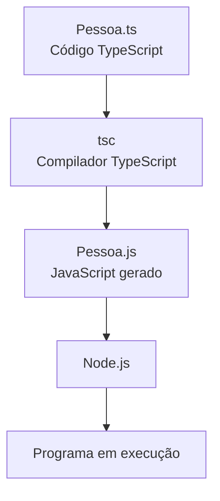
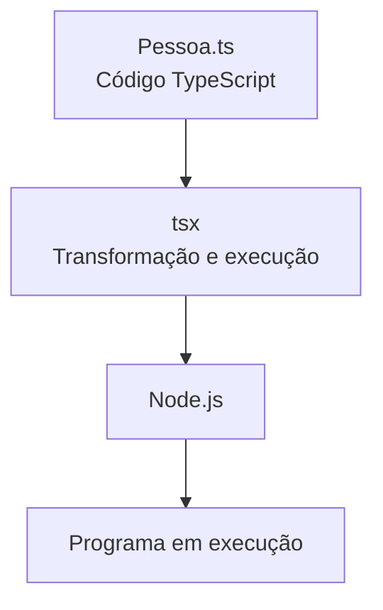

# 06 - TypeScript: Compilação e Execução com tsc e tsx

[](../LICENSE)
[](https://github.com/AntonioJavaDeveloper/mastering-typescript/stargazers)
[](https://github.com/AntonioJavaDeveloper/mastering-typescript/network/members)

## 🧭 Navegação

📂 [`README principal do repositório`](https://github.com/AntonioJavaDeveloper/mastering-typescript/blob/main/README.pt-BR.md)  
└── 📁 [`Introdução do capítulo`](./README.pt-BR.md)  
&emsp;&emsp;├── [`01 - JavaScript, ECMAScript, Node.js e Motores JavaScript`](./1-javascript-ecmascript-nodejs-e-motores.pt-BR.md)  
&emsp;&emsp;├── [`02 - TypeScript e Verificação de Tipos`](./2-o-que-e-typescript-e-verificacao-de-tipos.pt-BR.md)  
&emsp;&emsp;├── [`03 - Node.js e npm`](./3-nodejs-e-npm.pt-BR.md)  
&emsp;&emsp;├── [`04 - Gerenciamento de Dependências com npm`](./4-package-json-e-package-lock.pt-BR.md)  
&emsp;&emsp;├── [`05 - Instalação e Gerenciamento de Dependências`](./5-instalacao-e-gerenciamento-de-dependencias.pt-BR.md)  
&emsp;&emsp;├── [`06 - TypeScript e Execução com tsc e tsx`](./6-typescript-e-execucao-com-tsc-e-tsx.pt-BR.md) ← **você está aqui**  
&emsp;&emsp;├── [`07 - tsconfig.json: Configuração e Seleção de Arquivos`](./7-tsconfig-e-selecao-de-arquivos.pt-BR.md)  
&emsp;&emsp;├── [`08 - tsc: Argumentos, Arquivos e Projetos`](./8-tsc-argumentos-e-compilacao-de-projetos.pt-BR.md)  
&emsp;&emsp;└── [`09 - Verificação de Tipos e Execução Controlada`](./9-verificacao-de-tipos-e-execucao-controlada.pt-BR.md)

## 🎯 Introdução

Nesse documento vamos entender como o TypeScript pode ser verificado, transformado em JavaScript e executado pelo Node.js, comparando o processo convencional com a execução simplificada oferecida pelo `tsx`.

Nos documentos anteriores, conhecemos o TypeScript, o Node.js, o npm e as dependências do projeto. Também vimos que o TypeScript pode identificar problemas no código antes da execução. Agora, vamos acompanhar o caminho percorrido por um arquivo real do repositório: `Pessoa.ts`.

O TypeScript não é executado diretamente pelo Node.js como se fosse JavaScript comum. No fluxo convencional, o código TypeScript é transformado em JavaScript; depois, o Node.js executa o arquivo JavaScript gerado. O `tsx` simplifica esse processo durante o desenvolvimento, permitindo executar arquivos TypeScript sem exigir que um arquivo `.js` seja gravado manualmente no disco.

### 🏷️ O que será aprendido?

- O que são dependências de desenvolvimento e por que `typescript` e `tsx` estão em `devDependencies`.
- Qual é a função do compilador `tsc`.
- Como gerar um arquivo JavaScript a partir de `Pessoa.ts`.
- Como executar o JavaScript gerado usando Node.js.
- Para que serve a opção `--noEmit`.
- Como o `npx` encontra e executa ferramentas instaladas no projeto.
- Como executar o mesmo exemplo com `tsx` e comparar os dois fluxos.
- Por que executar um arquivo com sucesso não significa que ele passou na verificação de tipos.

## 🔄 Visão geral: dois caminhos para executar TypeScript

O processo convencional separa a transformação do código e sua execução:



Com `tsx`, a ferramenta transforma o código necessário para executá-lo sem exigir que um arquivo JavaScript correspondente seja salvo no projeto:



💡 **Conceito importante:** nos dois caminhos, o Node.js executa JavaScript. A diferença está em como o código TypeScript é preparado para a execução e se o JavaScript gerado precisa ser gravado como um arquivo no projeto.

## 🧰 Dependências de desenvolvimento

### 📦 O que significa `devDependencies`?

No arquivo `package.json`, a seção `devDependencies` reúne pacotes necessários para tarefas de desenvolvimento, como compilação, verificação de tipos, execução de exemplos e testes.

Neste repositório, os pacotes relevantes são:

```json
{
  "devDependencies": {
    "tsx": "^4.20.6",
    "typescript": "^7.0.2"
  }
}
```

As versões exibidas correspondem às declarações informadas para este projeto. O `package-lock.json` registra informações mais específicas sobre as versões resolvidas durante a instalação.

### 🛠️ Qual é o papel de cada pacote?

| Pacote ou ferramenta | Função |
|---|---|
| `typescript` | Fornece o compilador TypeScript, disponibilizado pelo comando `tsc`, além de outras ferramentas relacionadas. |
| `tsc` | Analisa o código TypeScript e, quando solicitado, gera arquivos JavaScript. Também pode verificar tipos sem gerar arquivos. |
| `tsx` | Permite executar arquivos TypeScript durante o desenvolvimento, transformando o código necessário para a execução. |
| `node` | Executa JavaScript no ambiente Node.js. |
| `npm` | Gerencia pacotes e executa os scripts declarados em `package.json`. |
| `npx` | Permite invocar executáveis de pacotes, aproveitando normalmente a instalação local do projeto quando disponível. |

📌 **Por que `typescript` e `tsx` são dependências de desenvolvimento?** Neste repositório, são ferramentas utilizadas para estudar, verificar e executar os exemplos. Por isso, ficam declaradas em `devDependencies`, em vez de serem tratadas como bibliotecas de execução da aplicação.

O projeto utiliza `tsx` em vez de `ts-node`. O `ts-node` é utilizado em vários projetos em `TypeScript` e tem uma proposta muito parecida com o `tsx`. Mas o `ts-node` não tem compatibilidade com as últimas versões do `TypeScript`. A escolha evita depender do fluxo do `ts-node` neste ambiente com uma versão recente do TypeScript; a compatibilidade entre versões de ferramentas deve sempre ser verificada na documentação dos projetos envolvidos.

## ⚙️ Conhecendo o compilador `tsc`

O `tsc` é o compilador do TypeScript. Ele pode verificar os tipos e transformar arquivos TypeScript em JavaScript.

Como ainda não criamos o arquivo `tsconfig.json`, neste primeiro exercício informaremos o arquivo de entrada e algumas opções diretamente no comando. Isso permite observar a compilação sem depender de uma configuração de projeto que será estudada no documento 07.

### 📂 Localizando o arquivo de exemplo

O arquivo utilizado neste capítulo é:

```text
src/
└── 02-typescript-environment-and-dependencies/
    └── Pessoa.ts
```

Os comandos seguintes devem ser executados a partir da raiz do repositório, onde estão o `package.json` e as dependências do projeto.

### 🔍 Verificando os tipos sem gerar JavaScript

Execute:

```bash
npx tsc --noEmit src/02-typescript-environment-and-dependencies/Pessoa.ts
```

A opção `--noEmit` solicita que o compilador faça a análise sem gravar os arquivos de saída.

Esse comando é útil quando o objetivo é verificar o código sem produzir um arquivo JavaScript. Como o arquivo é informado diretamente, esta verificação isolada não equivale à verificação de todo o projeto com suas futuras opções de `tsconfig.json`. A diferença será aprofundada nos documentos 07 e 08.

⚠️ **Atenção:** se o código tiver um erro de tipo, o compilador poderá informar o problema e terminar com um código de saída diferente de zero. Esse número serve como uma resposta automática para dizer ao sistema operacional — ou a quem chamou o programa — se a tarefa foi realizada com sucesso ou se ocorreu algum erro. ` 0 ` significa sucesso e *qualquer número diferente de zero (como 1, 2, 127, etc.) significa erro (o comando falhou por algum motivo).* Se não houver diagnósticos, isso significa apenas que a verificação realizada não encontrou erros dentro do escopo e das opções utilizados.

## 🏗️ Gerando JavaScript com `tsc`

Agora vamos seguir o processo convencional: compilar `Pessoa.ts` para gerar um arquivo `.js` e, em seguida, executar esse arquivo com Node.js.

### 📁 Criando uma pasta para a saída

Para manter o código-fonte TypeScript separado do JavaScript gerado, usaremos o diretório `dist/`. Dentro dele, criaremos subdiretórios para armazenar os arquivos gerados para cada versão do JavaScript.

Execute na raiz do repositório:

```bash
mkdir dist
mkdir dist/es2022 dist/es2015
```

Acabamos de criar os diretórios `dist/es2022` e `dist/es2015`


### 🔧 Compilando o arquivo para ES2022

Execute:

```bash
npx tsc src/02-typescript-environment-and-dependencies/Pessoa.ts --target ES2022 --module commonjs --outDir dist/es2022
```

O comando informa ao compilador:

| Opção | Finalidade |
|---|---|
| `src/02-typescript-environment-and-dependencies/Pessoa.ts` | Arquivo TypeScript que será usado como entrada. |
| `--target ES2022` | Define a versão de JavaScript de destino para a transformação. |
| `--module commonjs` | Define o formato de módulos CommonJS para a saída deste exercício. |
| `--outDir dist/es2022` | Direciona os arquivos gerados para o diretório `dist/es2022`. |

### 🔧 Compilando o arquivo para ES2015

Execute:

```bash
npx tsc src/02-typescript-environment-and-dependencies/Pessoa.ts --target ES2015 --module commonjs --outDir dist/es2015
```

O comando informa ao compilador:

| Opção | Finalidade |
|---|---|
| `src/02-typescript-environment-and-dependencies/Pessoa.ts` | Arquivo TypeScript que será usado como entrada. |
| `--target ES2015` | Define a versão de JavaScript de destino para a transformação. |
| `--module commonjs` | Define o formato de módulos CommonJS para a saída deste exercício. |
| `--outDir dist/es2015` | Direciona os arquivos gerados para o diretório `dist/es2015`. |

Depois da compilação, a estrutura esperada será semelhante a esta:

```text
mastering-typescript/
├── dist/
│   ├── es2015/
│   │   └── Pessoa.js
│   └── es2022/
│       └── Pessoa.js
├── src/
│   └── 02-typescript-environment-and-dependencies/
│       └── Pessoa.ts
├── package.json
└── package-lock.json
```

A saída pode variar se houver mudanças no código ou nas opções de compilação.

💡 **Por que gerar múltiplas versões?** Comparar os arquivos produzidos para diferentes versões do JavaScript ajuda a entender como o TypeScript adapta o código para ambientes mais antigos ou mais modernos. Isso permite visualizar o impacto da opção `--target` no resultado da compilação.

> Neste exemplo utilizamos commonjs para simplificar a execução dos arquivos gerados com Node.js. Em projetos modernos, é comum utilizar es2022, esnext ou nodenext. A explicação sobre módulos não é objeto dessa documentação.

### 🔎 Comparando os arquivos gerados

Para visualizar os arquivos JavaScript gerados, execute:

```bash
cat dist/es2015/Pessoa.js
```

e

```bash
cat dist/es2022/Pessoa.js
```

Embora ambos executem o mesmo comportamento, o código gerado apresenta diferenças interessantes. Um exemplo é o operador de coalescência nula (`??`), utilizado no setter da propriedade `nome`:

```ts
this.primeiroNome = partesDoNome[0] ?? "";
```

No arquivo gerado para **ES2022**, o operador é preservado porque essa versão do JavaScript possui suporte nativo ao recurso:

```js
this.primeiroNome = partesDoNome[0] ?? "";
```

Já no arquivo gerado para **ES2015**, o TypeScript precisa transformar o operador em uma expressão equivalente compatível com ambientes mais antigos:

```js
var _a;

this.primeiroNome = (_a = partesDoNome[0]) !== null && _a !== void 0 ? _a : "";
```

O operador `??` retorna o valor à esquerda quando ele não é `null` nem `undefined`; caso contrário, utiliza o valor à direita. Como o ES2015 não possui esse operador, o compilador gera uma verificação equivalente.

Esse é um exemplo de como o TypeScript adapta recursos modernos da linguagem para versões mais antigas do JavaScript quando utilizamos um `target` inferior. Quanto mais antiga for a versão de destino, maior tende a ser a quantidade de transformações realizadas durante a compilação.

⚠️ **Importante:** compilar não significa que todos os erros possíveis foram eliminados. O comportamento depende das opções utilizadas e do código analisado. Neste comando, não habilitamos explicitamente `strict`; as opções de configuração do projeto serão estudadas em outro documento.

## ▶️ Executando o JavaScript com Node.js

Depois de gerar os arquivos JavaScript, execute:

```bash
node dist/es2022/Pessoa.js
```

ou

```bash
node dist/es2015/Pessoa.js
```

O Node.js executa o arquivo JavaScript correspondente à versão gerada. Como as chamadas de `console.log` do exemplo `Pessoa.ts` estão comentadas, é esperado que o programa termine sem apresentar mensagens no terminal.

Isso não significa que a execução falhou: o programa simplesmente não possui instruções de saída ativas neste exemplo.

### 🧪 Observando o fluxo convencional

O processo realizado até aqui foi:

1. O arquivo `Pessoa.ts` contém o código TypeScript.
2. O comando `tsc` transforma esse código e gera os arquivos `dist/es2022/Pessoa.js` e `dist/es2015/Pessoa.js`.
3. O TypeScript adapta o código ao `target` informado. Por exemplo, o operador de coalescência nula (`??`) é preservado na saída ES2022 e transformado em verificações equivalentes na saída ES2015.
4. O comando `node` executa o JavaScript gerado.

Esse fluxo permite inspecionar os arquivos produzidos pelo compilador e entender como recursos modernos do JavaScript podem ser preservados ou transformados para manter compatibilidade com versões mais antigas da linguagem. Entretanto, ele exige uma etapa explícita de compilação antes de cada execução quando o código é alterado.

## ⚡ Conhecendo o `tsx`

O `tsx` simplifica a execução de arquivos TypeScript durante o desenvolvimento. Ele transforma o código necessário para a execução e integra esse processo ao ambiente Node.js, sem exigir que o desenvolvedor gere manualmente um arquivo `.js` no disco a cada alteração.

### 🚀 Executando `Pessoa.ts` com `tsx`

Na raiz do repositório, execute:

```bash
npx tsx src/02-typescript-environment-and-dependencies/Pessoa.ts
```

O comando executa o arquivo TypeScript informado. Como as instruções `console.log` do exemplo estão comentadas, a execução deve terminar sem exibir mensagens.

Ao contrário do fluxo convencional apresentado anteriormente, não precisamos executar primeiro `tsc` para criar `dist/Pessoa.js`.

### 🔍 O que o `npx` faz?

O `npx` permite invocar executáveis disponibilizados por pacotes. Neste projeto, como `tsx` e `typescript` estão instalados localmente, o comando pode utilizar os executáveis presentes na instalação local, sem exigir uma instalação global.

Também é possível executar as ferramentas por meio dos scripts definidos em `package.json`, como veremos adiante.

### ⚖️ Comparação entre `tsc` e `tsx`

| Característica | `tsc` + Node.js | `tsx` |
|---|---|---|
| Entrada do processo | Arquivo TypeScript informado ao compilador | Arquivo TypeScript informado ao `tsx` |
| Transformação do código | Realizada pelo compilador `tsc` | Realizada pelo fluxo de execução do `tsx` |
| Arquivo JavaScript gravado no projeto | Sim, quando a emissão está habilitada | Não é necessário gerar um arquivo `.js` no disco |
| Etapa de execução | Comando separado com `node` | Integrada ao comando `tsx` |
| Verificação completa de tipos garantida antes da execução | Não automaticamente; depende do comando e das opções | Não |
| Uso comum | Compilação explícita e inspeção dos artefatos gerados | Ciclo rápido de desenvolvimento |

📌 **Conceito essencial:** o `tsx` facilita a execução, mas não substitui a verificação de tipos. Um arquivo pode ser executado mesmo quando contém problemas que o compilador TypeScript identificaria em uma verificação apropriada.

💡 **Qual versão do JavaScript o `tsx` executa?**

O `tsx` não gera automaticamente uma versão específica de JavaScript como fizemos ao utilizar `tsc --target ES2015` ou `tsc --target ES2022`. Durante a execução, ele transforma o código TypeScript para uma forma compatível com a versão do Node.js utilizada. Quando existe um arquivo `tsconfig.json`, configurações como `target` e `module` podem influenciar esse processo. Na prática, o JavaScript efetivamente executado depende da combinação entre as opções do projeto e os recursos suportados pela versão do Node.js instalada.

Quando existe um arquivo tsconfig.json no projeto, o tsx pode utilizar diversas configurações definidas nele, como resolução de módulos, caminhos (paths), interoperabilidade entre módulos e outras opções relacionadas ao ambiente de execução. Isso ajuda a manter consistência entre o desenvolvimento e a compilação realizada posteriormente pelo tsc.

Entretanto, é importante lembrar que o objetivo principal do tsx é proporcionar uma execução rápida durante o desenvolvimento. Em produção, utilizamos o tsc para gerar explicitamente os arquivos JavaScript que serão distribuídos e executados.

## 🧩 Executando pelas ferramentas e pelos scripts do projeto

No documento anterior, conhecemos os scripts configurados no `package.json`:

```json
{
  "scripts": {
    "test": "echo \"Error: no test specified\" && exit 1",
    "check": "tsc --noEmit",
    "dev": "tsx",
    "start": "tsc --noEmit && tsx"
  }
}
```

Esses são os scripts relevantes para o capítulo, apresentados aqui como referência; não representam necessariamente todo o conteúdo do arquivo.

### 🔎 Verificando o projeto

```bash
npm run check
```

Esse script executa `tsc --noEmit`. Como não informa um arquivo TypeScript diretamente, o compilador utiliza o contexto de projeto aplicável. Quando houver um `tsconfig.json` válido na raiz, ele será usado para determinar as opções e os arquivos do projeto.

⚠️ **Estado atual do capítulo:** o `tsconfig.json` ainda será criado e explicado em um documento posterior. Portanto, o comportamento de `npm run check` poderá ser diferente até que a configuração do projeto esteja disponível.

### 🚀 Executando um arquivo com `dev`

```bash
npm run dev -- src/02-typescript-environment-and-dependencies/Pessoa.ts
```

O separador `--` indica ao npm que os argumentos seguintes devem ser repassados ao comando do script. Neste caso, o caminho do arquivo é encaminhado ao `tsx`.

### 🛡️ Verificando antes de executar com `start`

```bash
npm start -- src/02-typescript-environment-and-dependencies/Pessoa.ts
```

O script `start` executa primeiro `tsc --noEmit` e, se a verificação terminar com sucesso, executa `tsx` com o arquivo informado.

O operador `&&` faz com que o segundo comando só seja executado quando o primeiro termina com código de saída zero. Assim, o fluxo impede a execução seguinte quando a verificação reporta uma falha.

Esse script verifica o projeto no contexto de configuração aplicável; não verifica exclusivamente o arquivo passado ao `tsx`. Por isso, erros em outros arquivos incluídos no projeto também podem impedir a execução.

O comportamento detalhado de `tsconfig.json`, da seleção de arquivos e dos argumentos do compilador será explorado nos documentos 07, 08 e 09.

## 🧠 Consolidando o aprendizado

### 🗺️ Qual comando utilizar?

| Necessidade | Comando |
|---|---|
| Verificar um arquivo sem gerar JavaScript | `npx tsc --noEmit src/02-typescript-environment-and-dependencies/Pessoa.ts` |
| Gerar JavaScript a partir de `Pessoa.ts` | `npx tsc src/02-typescript-environment-and-dependencies/Pessoa.ts --target ES2022 --module commonjs --outDir dist` |
| Executar o JavaScript gerado | `node dist/Pessoa.js` |
| Executar TypeScript diretamente com `tsx` | `npx tsx src/02-typescript-environment-and-dependencies/Pessoa.ts` |
| Verificar os tipos usando o script do projeto | `npm run check` |
| Executar um arquivo com o script de desenvolvimento | `npm run dev -- src/02-typescript-environment-and-dependencies/Pessoa.ts` |
| Verificar antes de executar | `npm start -- src/02-typescript-environment-and-dependencies/Pessoa.ts` |

### ✅ Verificação de conhecimento

- [ ] A diferença entre TypeScript e JavaScript foi compreendida.
- [ ] O papel do compilador `tsc` está claro.
- [ ] Foi possível gerar o arquivo `dist/Pessoa.js`.
- [ ] O JavaScript gerado foi executado com Node.js.
- [ ] A diferença entre `--noEmit` e a emissão de arquivos foi compreendida.
- [ ] O arquivo `Pessoa.ts` foi executado com `tsx`.
- [ ] Está claro que `tsx` não garante a verificação completa de tipos antes da execução.
- [ ] Está clara a diferença entre os comandos diretos e os scripts do npm.

## 📚 Leitura complementar

Para aprofundar os conceitos apresentados, consulte a documentação oficial:

- 📘 [TypeScript — Documentação oficial](https://www.typescriptlang.org/docs/)
- 🛠️ [TypeScript — Compiler Options](https://www.typescriptlang.org/docs/handbook/compiler-options.html)
- 🟢 [Node.js — Documentação oficial](https://nodejs.org/docs/latest/api/)
- 📦 [npm — Scripts](https://docs.npmjs.com/cli/v10/using-npm/scripts)
- ⚡ [tsx — Repositório e documentação](https://github.com/privatenumber/tsx)

## 🤝 Contribuições

Se este projeto ajudou ou inspirou você, considere deixar uma estrela ⭐ no repositório!

Sinta-se à vontade para abrir issues com sugestões, correções ou dúvidas. Este repositório é um espaço voltado à evolução constante e à consolidação de boas práticas no desenvolvimento de software com TypeScript.

Toda colaboração construtiva será analisada com atenção.

## 🔗 Navegação rápida

⬅️ Retornar à [05 - Instalação e Gerenciamento de Dependências](5-instalacao-e-gerenciamento-de-dependencias.pt-BR.md)

➡️ Avançar para [07 - tsconfig.json: Configuração e Seleção de Arquivos](7-tsconfig-e-selecao-de-arquivos.pt-BR.md)

🏠 Retornar ao [README principal do repositório](../../README.pt-BR.md)

## 📫 Contato

Caso queira trocar experiências sobre desenvolvimento de software, arquitetura de aplicações, Java, TypeScript ou tecnologia em geral, você pode me encontrar através dos canais abaixo:

- 🌐 [javadeveloper.com.br](https://javadeveloper.com.br)
- 💼 [LinkedIn](https://www.linkedin.com/)
- 📧 antonio@javadeveloper.com.br

**Developed by AntonioJavaDeveloper**
